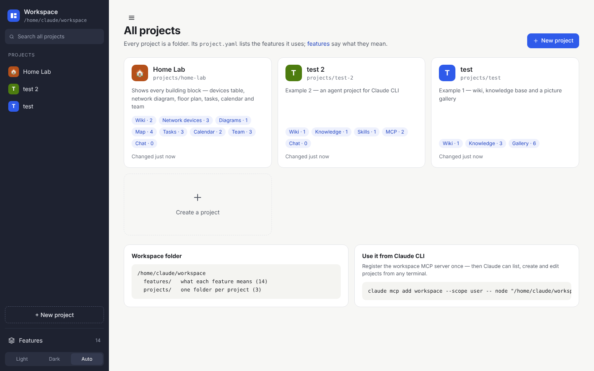
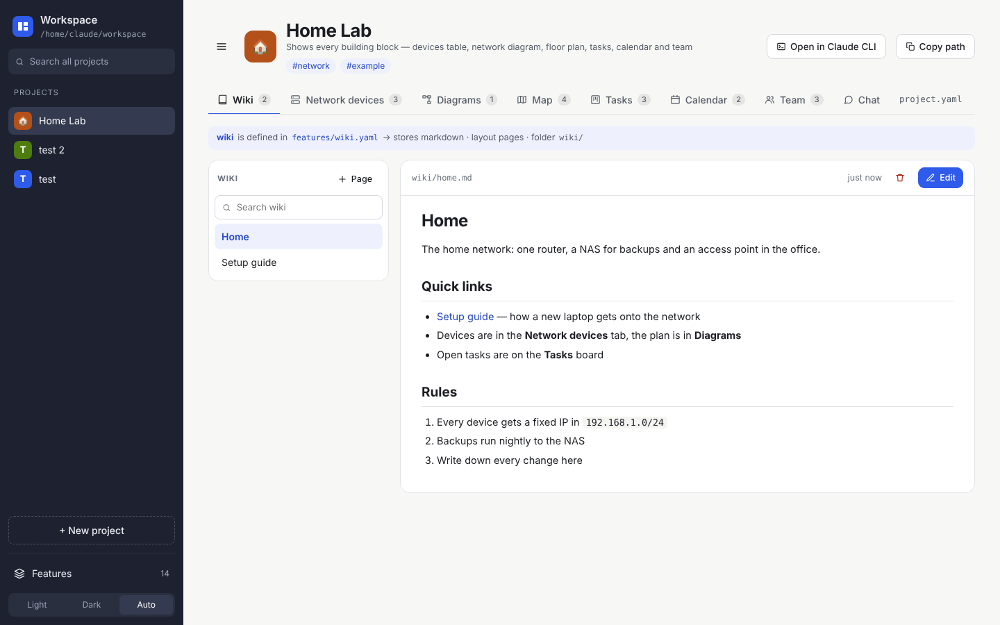
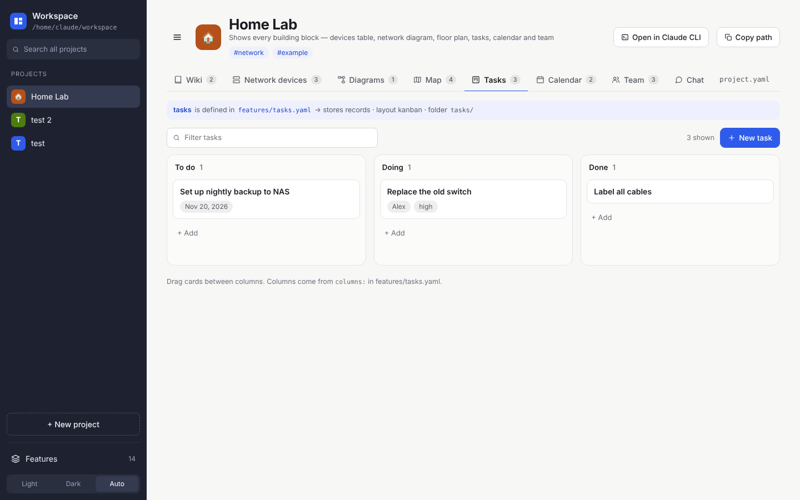
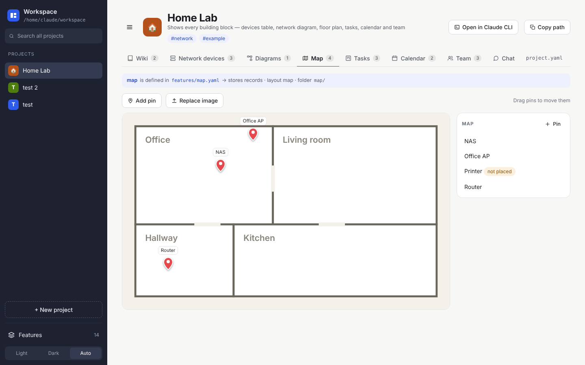
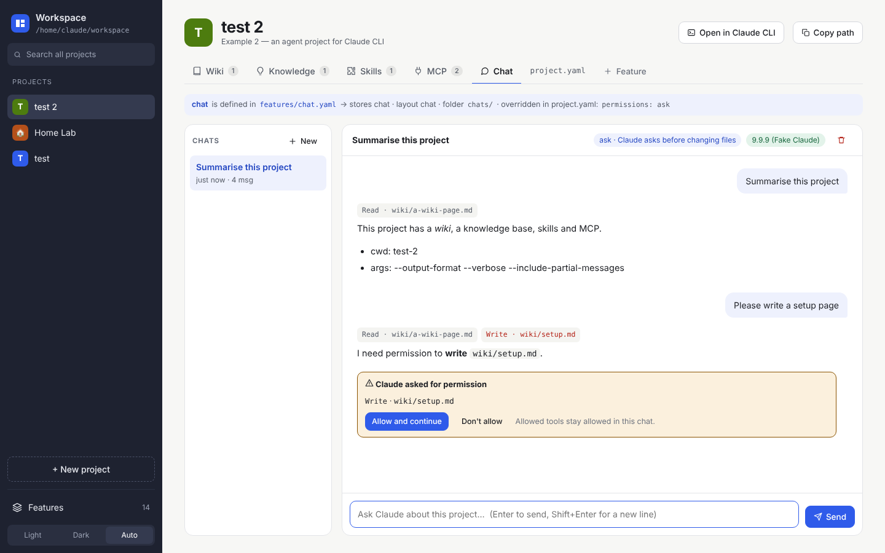
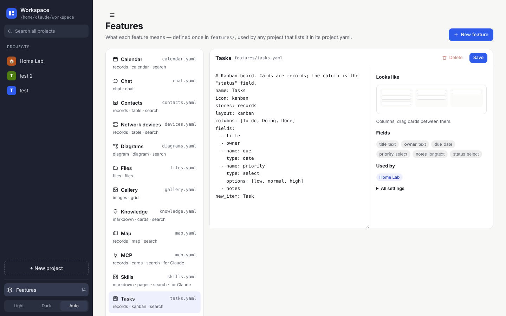
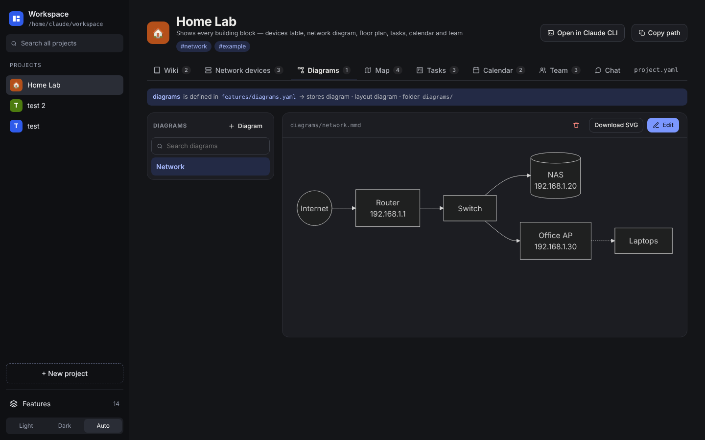

# Project Workspace

One workspace for very different projects. A project's `project.yaml` says **which features** it has, and `features/*.yaml` says **what they mean**. There is no database; everything is plain files. It works with **Claude CLI**: you can chat inside a project, and skills, MCP connections and a workspace MCP server are included.



## Start

You need [Node.js](https://nodejs.org) 18 or newer (LTS). Nothing else gets installed.

- **Windows:** double-click `start.bat`
- **macOS / Linux:** `./start.sh`
- or run `node app/server.js` yourself, then open http://localhost:4321

The chat feature also needs [Claude CLI](https://docs.claude.com/en/docs/claude-code), installed and signed in (`claude` in a terminal).

## How it works

```yaml
# projects/test/project.yaml
name: test
wiki:
  - a wiki page
knowledge:
  - a knowledge base
gallery:
  - a picture gallery
```

```yaml
# features/wiki.yaml  — defined once, used by every project that says "wiki:"
name: Wiki
stores: markdown
layout: pages
search: true
```

Each feature key becomes a tab on the project page. The content lives in the project folder (`projects/test/wiki/a-wiki-page.md`, …), so you can edit it in any editor or have Claude edit it.

**Building blocks:** pages · cards · list · picture grid · files · table · kanban · calendar · org chart · offline map (your own image with pins) · Mermaid diagrams · chat with Claude CLI.

**Starter features:** wiki, knowledge, gallery, files, skills, mcp, chat, tasks, calendar, team, map, diagrams, contacts, devices. You can add your own under *Features → New feature*, by copying a YAML file, or by asking Claude.

| | |
|---|---|
|  |  |
|  |  |
|  |  |

## Claude CLI

- **Chat tab:** runs `claude` inside the project folder. Permissions are set per project in `project.yaml`:
  ```yaml
  chat:
    permissions: ask    # ask | auto | read-only
  ```
- **Skills** are written to `.claude/skills/<name>/SKILL.md` and **MCP connections** to `.mcp.json`. Claude CLI picks both up when started in the project folder ("Open in Claude CLI").
- **Workspace MCP server:** lets Claude list, create and edit projects from anywhere:
  ```
  claude mcp add workspace --scope user -- node "C:\path\to\Workspace\app\mcp.js"
  ```

## More

- Full design and rebuild guide: [docs/DESIGN.md](docs/DESIGN.md)
- Bugs and ideas: [Issues](https://github.com/GFGMNET/Workspace/issues)
- Tests: `npm test`
- Settings (environment variables): `PORT` (default 4321), `WORKSPACE_DIR` (data folder, default this folder), `CLAUDE_COMMAND` (default `claude`)

Mermaid (MIT) is bundled in `app/public/vendor/` for offline diagrams.
