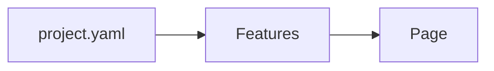

# A wiki page

This page is a plain Markdown file: `projects/test/wiki/a-wiki-page.md`.
Edit it here or in any editor — the workspace just reads the file.

- **Edit** with live preview (Ctrl+S saves)
- Link pages with [[A wiki page]] or create a new one: [[Another page]]
- Diagrams work inside pages too:

