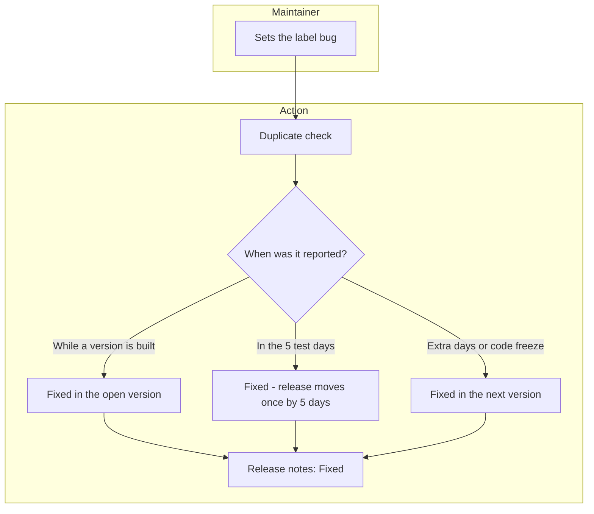

# How a bug is handled

Start: [ISSUE-WORKFLOW](ISSUE-WORKFLOW.md) · Known bugs: [wiki](https://github.com/GFGMNET/Workspace/wiki/Known-bugs)

**Details (for Claude):**
- Serious bugs go to the [urgent fix workflow](URGENT-FIX-WORKFLOW.md), not here.
- Duplicate check: `duplicate-check.yml` compares with all bugs (open and fixed) → comment + label `possible-duplicate`.
- Every fix gets an automatic test; the commit says `Closes #number`. Fixed bugs are listed on the wiki page *Known bugs*.
