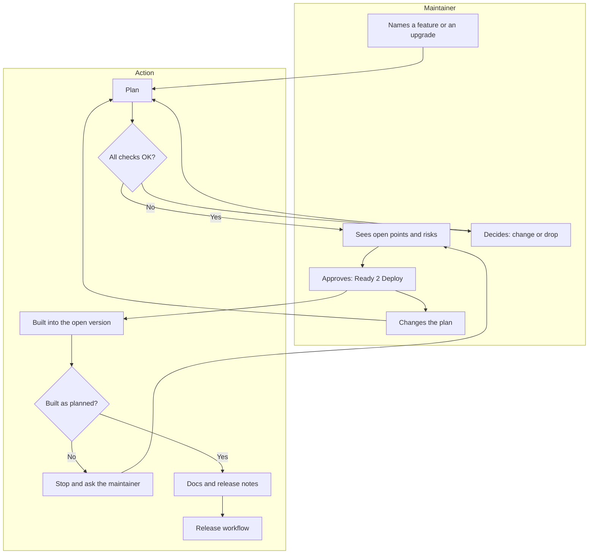

# How a new feature is made

Plans: [docs/plans](plans) · Checks: [docs/plans/checks](plans/checks)

**Details (for Claude):**
- Plan: 8 parts (CLAUDE.md); an upgrade gets its own short plan "<Feature>: <upgrade>" that refers to the existing plan.
- Every function is checked (`docs/plans/checks/`). A changed plan loses Ready 2 Deploy until the new part is checked and approved again.
- Docs: wiki in `docs/wiki-next/vX.Y.Z/`, `docs/readme-next/README.md`, `docs/releases/vX.Y.Z.md`; a built-in feature's `version:` goes up.
