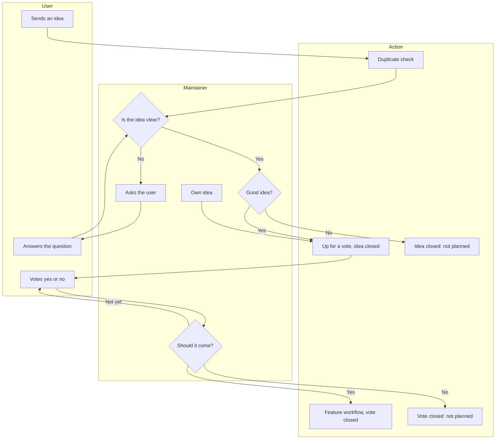

# How ideas become a vote

Form: [New idea](https://github.com/GFGMNET/Workspace/issues/new?template=new-idea.yml) · Votes: [wiki](https://github.com/GFGMNET/Workspace/wiki/Vote-for-features)

**Details (for Claude):**
- An idea arrives by the form *New idea* (label `idea` set automatically) or as a normal issue (the maintainer sets `idea`). His own ideas go straight to a `Vote: …` issue.
- Duplicate check: `duplicate-check.yml` compares with open ideas and votes → comment + label `possible-duplicate`. A duplicate is closed with "Already known: #number".
- Up for a vote: new issue `Vote: …`, label `vote`, text "Idea from #number (thanks @user)"; the idea is closed with "Now up for a vote: #number".
- Not planned: closed as *not planned* with "This will not be added. Thanks @user for the idea!".
- Votes count only on the first post; the wiki list is updated daily. Votes never move a release.
