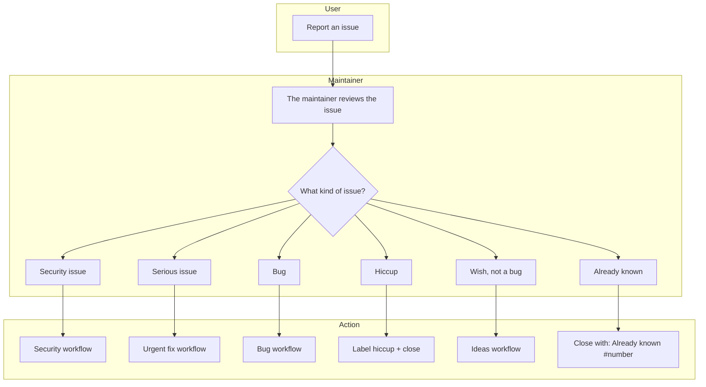

# How an issue is handled (start here)

Report: [new issue](https://github.com/GFGMNET/Workspace/issues/new/choose)

**Details (for Claude):**
- Workflows: [SECURITY](SECURITY-WORKFLOW.md) · [URGENT-FIX](URGENT-FIX-WORKFLOW.md) · [BUG](BUG-WORKFLOW.md) · [IDEAS](IDEAS-WORKFLOW.md)
- Only the maintainer decides the kind and sets the label (`bug`, `hiccup`, `security`). Hiccups are listed on the wiki page *Known hiccups* and never delay a release.
- Unclear reports: the maintainer asks on the issue first.
