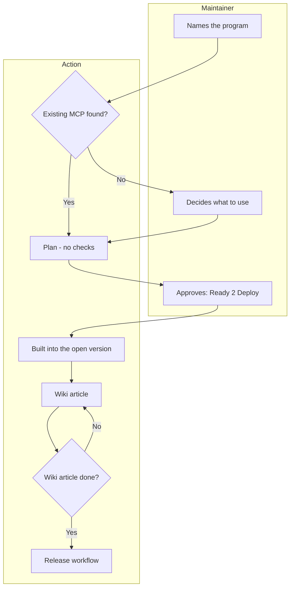

# How an MCP is added

Plans: [docs/plans](plans) (e.g. [BLENDER.md](plans/BLENDER.md))

**Details (for Claude):**
- Name = the program's name. Switched on per project with `programs:` in `project.yaml`; results go into the project folder named after the program (`blender/`, …).
- No checks, no own beta; it goes out with its version — but only together with its wiki article (what is needed, how to connect, a chat example).
