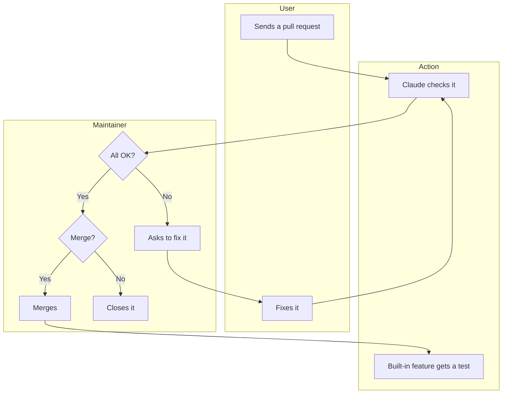

# How a pull request from others is handled

Pull requests: [open](https://github.com/GFGMNET/Workspace/pulls)

**Details (for Claude):**
- Claude checks: what it changes, tests on Windows + Linux, Rust security check + CodeQL, no secrets or client data, a new function has an approved plan, docs updated — and tells the maintainer in plain words.
- Only the maintainer merges. A built-in feature (`app/starter/features/`) gets a test before it goes into a release.
