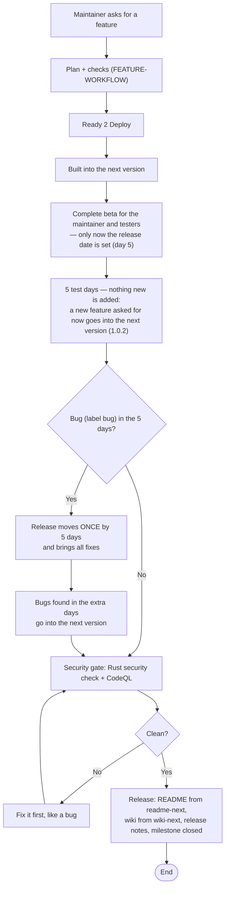

# How a version is released (1.0.1 and later)

Releases: [GitHub Releases](https://github.com/GFGMNET/Workspace/releases) · Notes: [docs/releases](releases) ([template](releases/TEMPLATE.md))

No release date is fixed in advance: as quick and as safe as possible — the date is set when the complete beta is out.
Hiccups never delay a release. The day-5 step runs as a scheduled task that Claude sets when the complete beta is out.
