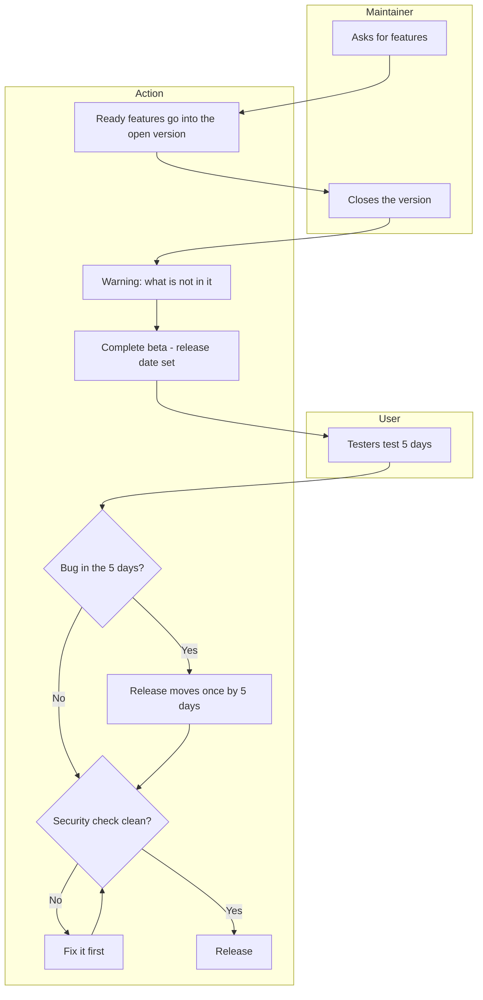

# How a version is released (1.0.1 and later)

Releases: [GitHub Releases](https://github.com/GFGMNET/Workspace/releases) · Notes: [docs/releases](releases) ([template](releases/TEMPLATE.md))

**Details (for Claude):**
- No release date in advance: the date is set when the complete beta is out (day 5, or once 5 days later). The day-5 step runs as a scheduled task.
- For now the maintainer closes a version ("close 1.0.x"); later it may close by itself after a fixed number of days.
- Not Ready 2 Deploy when the version closes → not in it, with a warning; it goes into the next version once ready.
- Nothing new in the test days; bugs in the extra days → next version; hiccups never delay.
- Release: README from `docs/readme-next/`, wiki from `docs/wiki-next/`, release notes, milestone closed.
