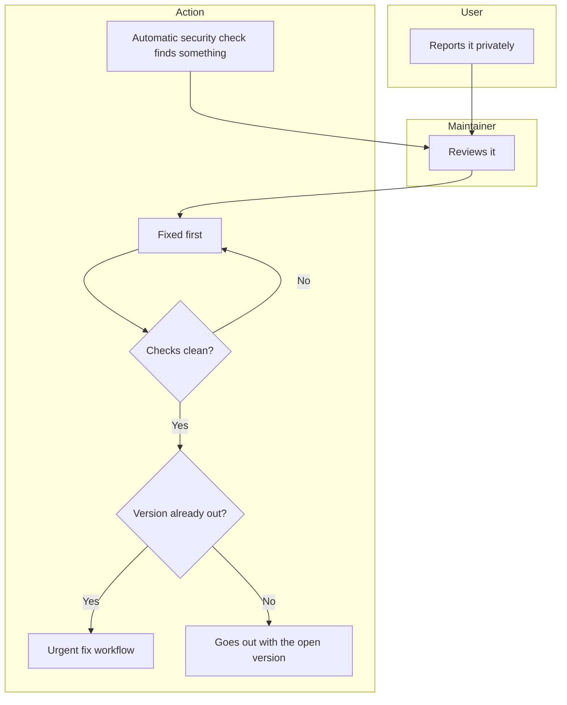

# How a security issue is handled

Known security issues: [wiki](https://github.com/GFGMNET/Workspace/wiki/Known-security-issues)

**Details (for Claude):**
- Private report: GitHub → Security tab → *Report a vulnerability* (switched on).
- Automatic checks: Rust security check (`rust-security.yml`, its message gets the label `security-check`) and CodeQL.
- A real problem gets its own issue with the label `security`. Fixed first — also during a code freeze. A Rust library: Actions *Rust lock update* with the crate names → commit the new `rust/Cargo.lock` from branch `rust-lock-update`.
- Never release with a failing security check.
