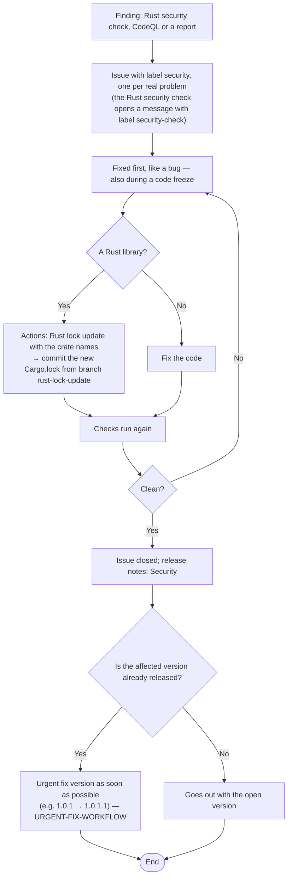

# How a security finding is handled

Checks: [Rust security check](https://github.com/GFGMNET/Workspace/actions/workflows/rust-security.yml) · [CodeQL](https://github.com/GFGMNET/Workspace/security/code-scanning) · Open: [label security](https://github.com/GFGMNET/Workspace/issues?q=is%3Aissue+is%3Aopen+label%3Asecurity) · Wiki: [Known security issues](https://github.com/GFGMNET/Workspace/wiki/Known-security-issues)

Never release with a failing security check.
