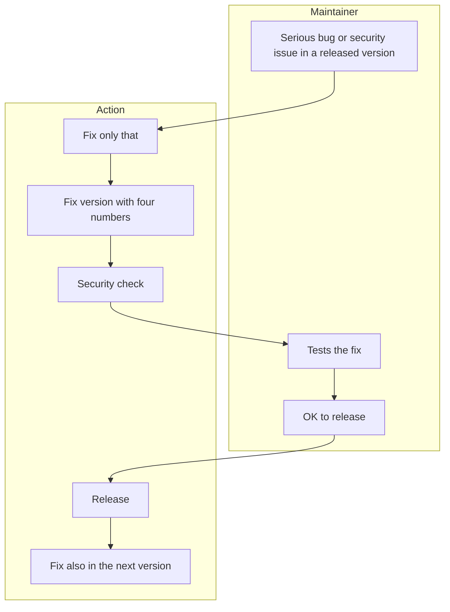

# How a serious bug is fixed (urgent fix)

Start: [ISSUE-WORKFLOW](ISSUE-WORKFLOW.md)

**Details (for Claude):**
- Only the maintainer decides what is serious. A security issue in a released version is always an urgent fix, as soon as possible. Lost data is the user's responsibility (wiki *Backup*); "doesn't start" → FAQ first.
- Version numbers: 1.0 → 1.0.0.1, 1.0.1 → 1.0.1.1, 1.0.1.2 … The app compares all four numbers (#123).
- Security check = Rust security check + CodeQL, both clean. He tests as long as the fix needs. The next normal version keeps its date.
