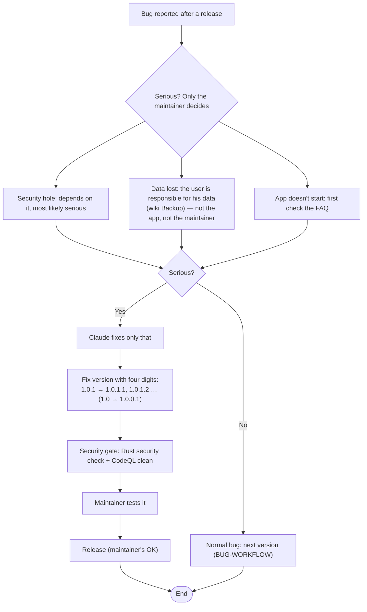

# How a serious bug is fixed (urgent fix)

Bugs: [BUG-WORKFLOW](BUG-WORKFLOW.md) · Backup: [wiki Backup](https://github.com/GFGMNET/Workspace/wiki/Backup) · [FAQ](https://github.com/GFGMNET/Workspace/wiki/FAQ)

