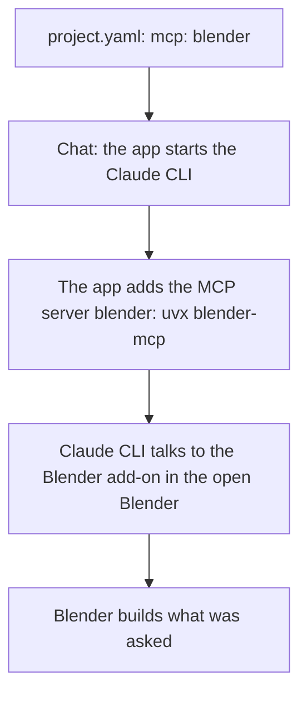

# Plan: Blender


## 1) Name

Blender

## 2) Planned release version

1.1

## 3) Feasible? Checked per function, with the result

| part | desc | state | suggestion |
|---|---|---|---|
| Project | MCP Blender is connected in a project | not checked — no checks for MCPs (decision 5) | — |
| Blender | the Claude CLI builds things in Blender through MCP | not checked — no checks for MCPs (decision 5) | — |

Checked: 0 · Unchecked: 2 (no checks for MCPs, decision 5) · Failed: 0

## 4) Description

In a project, MCP Blender is connected. Someone writes in the chat, e.g. "Build me a Medieval Tavern in Blender, use Low
Poly", and the Claude CLI does it in Blender through MCP. The app itself doesn't need to show feedback.

## 5) Open points, only about this feature

| id | question |
|---|---|
| 1 | How the result gets into the project (decision 9): the app tells Claude in every chat with this MCP to keep the `.blend` files (and exports) in the folder `blender/` of the project — OK, and is that folder name OK? |

## 6) Decisions, only about this feature

| id | decision |
|---|---|
| 1 | The name of an MCP is the name of the program it uses: "Blender". |
| 2 | For MCPs, the existing solution is used if possible: "Blender MCP" (add-on in Blender + MCP server, https://github.com/ahujasid/blender-mcp). |
| 3 | No test phase for the MCP; instead a wiki article: what is needed and how to connect Blender and the app. |
| 4 | Switched on per project in `project.yaml`: `mcp:` with `blender` in it. |
| 5 | For MCPs only: no checks in point 3 and no test phase; an MCP plan can be Ready 2 Deploy without checks (2026-11-20). |
| 6 | Switching on in the app: project settings (gear) → section "MCP" with a checkbox per program, as in the [approved screen](img/mcp-settings.png); ticking writes `mcp:` in `project.yaml`. |
| 7 | No own beta for an MCP: it goes out with the release of its version (2026-11-20). |
| 9 | Every result of the MCP is saved in the Workspace project (its folder) — for all MCPs (2026-11-20). |

## 7) Risks

| id | risk | suggestion |
|---|---|---|
| 1 | Not checked (decision 5): whether it works is only seen when it is used. | The wiki article says what is needed and how to connect (decision 3). |
| 2 | Blender MCP lets Claude run Python code inside Blender; that code can do anything Blender can do on the PC. | The chat's permission questions stay on (Claude asks before a tool is used, unless allowed). |
| 3 | Blender MCP is someone else's project; it can change or stop. | Decision 2 ("if possible"): if it stops working, a new plan. |
| 4 | Blender has to be open with the add-on connected, and `uv` installed; otherwise the Blender tools answer with an error in the chat. | The wiki article. |

## 8) Detail workflow

### 8a) Flow diagram



### 8b) The YAML file

```yaml
mcp:
  - blender
```

### 8c) How it is done

| id | desc |
|---|---|
| 1 | The app reads `mcp:` from `project.yaml` (a list of names). |
| 1b | Project settings (gear): section "MCP" with a checkbox per known program (Blender; Unity and Unreal shown as planned) — ticking adds or removes the name in `mcp:` (decision 6). |
| 2 | Known MCPs in the app: `blender` → command `uvx blender-mcp` (decision 2). Unknown names are ignored with a note in the chat. |
| 3 | `rust/crates/pw-server/src/chat.rs`: when a chat starts the Claude CLI, the known MCPs of the project are added to `--mcp-config` (like the project's `.mcp.json` today). |
| 4 | **Required** — wiki article "MCP: Blender" (decision 3); Blender is only released with it: what is needed (Blender, the Blender MCP add-on `addon.py`, `uv`), how to connect (install the add-on, Blender sidebar → BlenderMCP → "Connect to Claude", `mcp: [blender]` in `project.yaml`), what to write in the chat. Done when: the article is in `docs/wiki/` and linked in the sidebar. |
| 5 | Docs: DESIGN.md, REQUIREMENTS.md (→ wiki "Requirements"), release notes `docs/releases/v1.1.0.md`. |
| 6 | No own beta (decision 7): goes out with the release 1.1, with your OK. |
