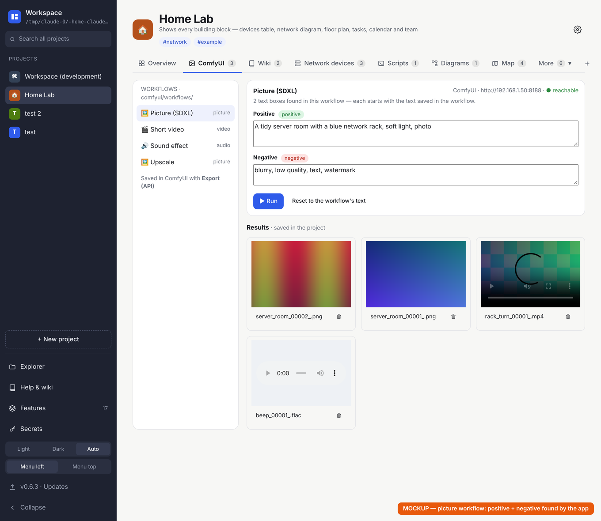
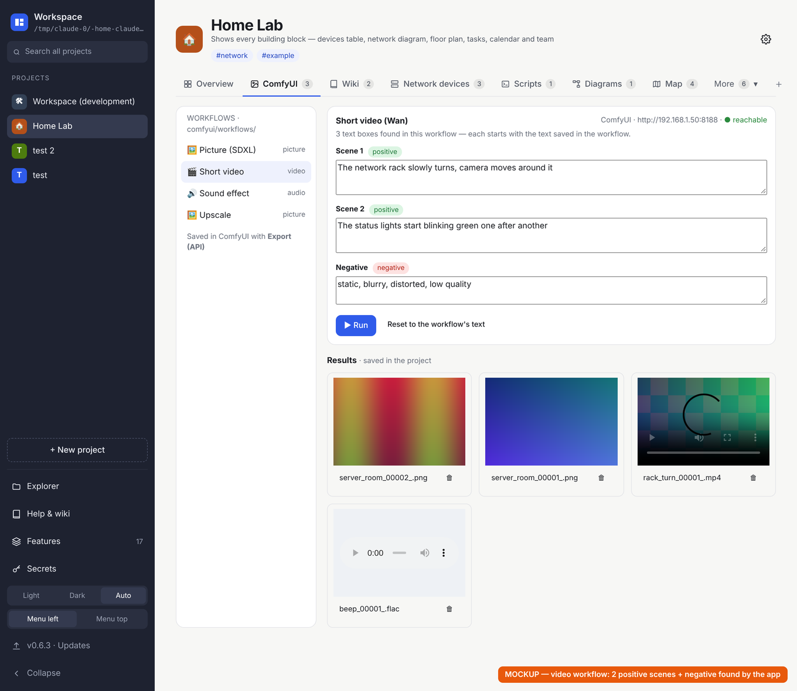
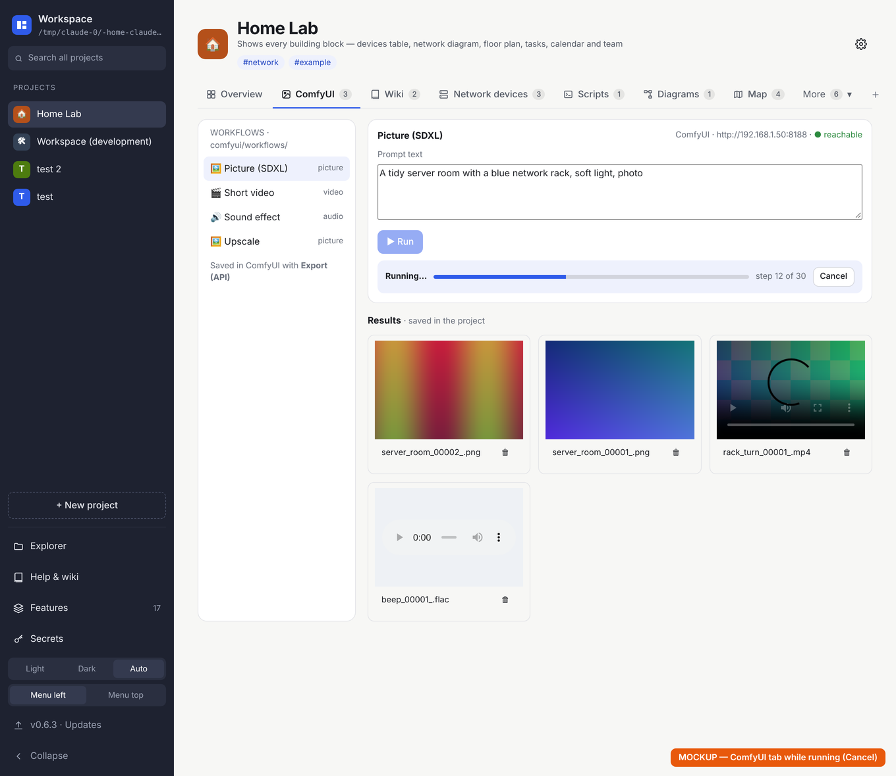
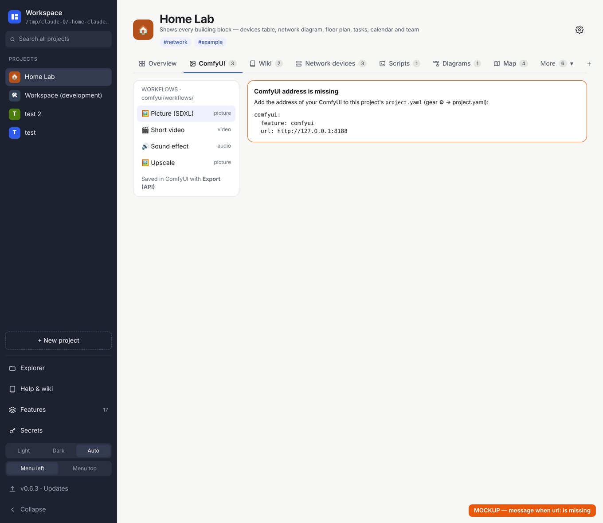
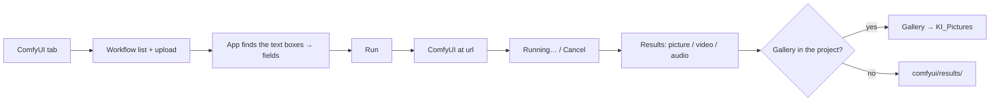

# Plan: ComfyUI

**Ready 2 Deploy** (approved by the maintainer 2026-11-23)

## 1) Name

ComfyUI

## 2) Planned release version

1.0.1 — 2 Dec 2026 (1.0.1 and 1.0.2 merged into 1.0.1 by the maintainer 2026-11-24)

## 3) Feasible? Checked per function, with the result

Checked against a real ComfyUI v0.46.2 (latest release, run on the processor with test workflows that need no AI model)
and the 1.0 app server, on Linux (WebKit) and Windows (Edge = WebView2). Checks: `docs/plans/checks/comfyui-check.js`,
`comfyui-media-check.js`, `comfyui-gallery-check.js` — GitHub Actions "Plan checks", plan = comfyui
(runs 45123849658, 45125890094, 45129057821, 45129935538).

- Workflows in the project are found and listed — **OK**
- The app finds the text boxes by itself — picture workflow (positive + negative) — **OK**
- The app finds the text boxes by itself — video workflow (two positive scenes + negative, through the video box) — **OK**
- The app finds the text boxes by itself — Flux workflow (two text fields in one box) — **OK**
- A text box filled in by the app is used in the run — **OK**
- Run, and the app sees when it is done — **OK**
- Results come back: picture (png), video (mp4, webm), audio (flac) — **OK**
- Results saved in the project — **OK**
- ComfyUI reached by its network address — **OK**
- Results shown and played in the ComfyUI tab — Linux and Windows — **OK**
- Results in the Gallery (album KI_Pictures), delivered by the app, shown and played (also jumping in them) — Linux and Windows — **OK**
- **+** uploads a workflow into `comfyui/workflows/` — **OK**

Checked: 12 · Failed: 0 · Unchecked: 0

## 4) Description

A feature with its own tab **ComfyUI**, only the screen — Claude is not used. On the left: the project's workflows, each
with a label picture / video / audio, and **+** to upload one. When you select a workflow, the app shows one field for each
text box it finds in it, marked positive or negative, filled with the workflow's text. **Run** sends it to ComfyUI; while
it works, the tab shows "Running…" with **Cancel**. The results (pictures, video, audio) appear in the tab's gallery and can
be deleted. They are saved once in the project: in the Gallery tab's album **KI_Pictures** when the project has a Gallery,
otherwise in `comfyui/results/`. ComfyUI runs on the same PC or in the network; its address is in `project.yaml`.






## 5) Open points, only about this feature

None (all answered 2026-11-23).

## 6) Decisions, only about this feature

| id | decision |
|---|---|
| 1 | Its own feature and tab, called **ComfyUI**; only the screen, no Claude. LM Studio gets its own plan. |
| 2 | Version 1.0.1 (was 1.0.2; merged 2026-11-24). |
| 3 | List of workflows → fields → **Run** → results in a gallery, saved in the project. |
| 4 | Results: pictures, video and audio. |
| 5 | ComfyUI on the same PC or in the network; the address is `url:` in `project.yaml`. If it is missing, a message is shown. |
| 6 | Workflows live in `comfyui/workflows/` and are saved in ComfyUI with **Export (API)** — this must be in the wiki. |
| 7 | The app finds every text box itself (no preparing in ComfyUI): one field per box, named after the box (box + field name if one box has two), marked positive / negative, starting with the workflow's text. |
| 8 | A label picture / video / audio next to each workflow. |
| 9 | A **+** button uploads a workflow. |
| 10 | While running: "Running…", progress and **Cancel**. |
| 11 | A result can be deleted. |
| 12 | Results also in the Gallery tab, album **KI_Pictures**; the Gallery learns to show and play video and audio (video: first picture with a play button; audio: speaker symbol with a player). |
| 13 | Each result is kept only once: with a Gallery in **KI_Pictures** (the ComfyUI tab shows it from there), without a Gallery in `comfyui/results/`. Deleting in one tab removes it from both. |
| 14 | No Gallery: results only in the ComfyUI tab. A Gallery added later: the earlier results are moved into KI_Pictures once. |
| 15 | A **Reset to the workflow's text** button next to Run. |

## 7) Risks

| id | Risk | Suggestion |
|---|---|---|
| 1 | ComfyUI is still version 0.x and changes often (box names, its interface). | Run the plan check again against the newest ComfyUI before the release. |
| 2 | ComfyUI has no password; in the network anyone can use it, nothing is encrypted. | Wiki note: only in your own network. |
| 3 | Workflows that need models or extra boxes that are not installed in ComfyUI fail. | Show ComfyUI's own error message. |
| 4 | Long videos: the app sends files in one piece; checked only with 1-second files. | Check again with a long video before the release; if it is slow, the app learns to send files in parts. |
| 5 | Real runs take minutes. | The app asks ComfyUI every few seconds whether it is done; the screen stays usable. |
| 6 | A workflow saved normally (not with Export (API)) is uploaded. | The app says "Save it in ComfyUI with Export (API)". |
| 7 | Videos make the project and the backups big. | Wiki note. |

## 8) Detail workflow

### 8a) Flow



### 8b) The YAML file

```yaml
comfyui:
  feature: comfyui
  url: http://192.168.1.50:8188    # ComfyUI in the network, or http://127.0.0.1:8188 on the same PC
```

### 8c) How it is done

| id | desc |
|---|---|
| 1 | New starter feature `comfyui` with its own tab (decision 1); message when `url:` is missing (decision 5). |
| 2 | Workflow list from `comfyui/workflows/` with the label (decision 8) and **+** upload (decision 9); message when a file is not in API format (risk 6). |
| 3 | The app finds the text boxes and shows one field each — named, positive/negative, with the workflow's text; **Reset** (decisions 7, 15). |
| 4 | **Run** sends the workflow to `url:`; "Running…", progress and **Cancel** (decision 10); it asks regularly until done (risk 5); ComfyUI's error message when it fails (risk 3). |
| 5 | Results fetched and saved once — KI_Pictures or `comfyui/results/`; the tab's gallery with delete (decisions 4, 11, 13). |
| 6 | Gallery added later: earlier results moved into KI_Pictures once (decision 14). |
| 7 | The Gallery shows and plays video and audio (decision 12). |
| 8 | Automatic tests against a fake ComfyUI (contract tests). Before the release: the plan check again against the newest ComfyUI, and with a long video (risks 1, 4). |
| 9 | Wiki page "ComfyUI" with *What you need* on top (ComfyUI installed and running, its address, **Export (API)**, network note), the Gallery page, DESIGN.md, REQUIREMENTS.md, the release notes of 1.0.2. |
