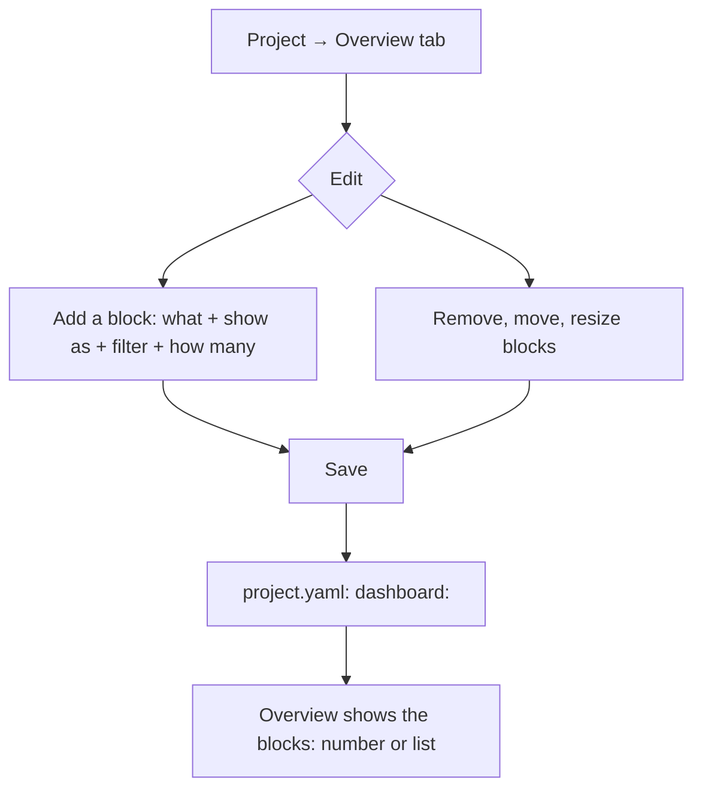

# Plan: Dashboard

**Released in 1.0.1** (26 Nov 2026) · was **Ready 2 Deploy**

## 1) Name

Dashboard

## 2) Planned release version

1.0.1 (all remaining plans in one version — maintainer's decision 2026-11-25; built from 27 Nov, released 5 days after the complete beta, or once 5 days later if a bug is reported in the test days)

## 3) Feasible? Checked per function, with the result

| part | desc | state | result |
|---|---|---|---|
| Edit | "Edit" button on the Overview → edit mode | checked OK | test page, Chromium (Windows) and WebKit (Linux) on GitHub's machines |
| Blocks | add a block: what (any feature of the project) + show as (number or list) + simple filter (+ how many, for lists) | checked OK | every kind of feature gives a number and a list with a filter: wiki, records (tasks, team, map …), files, diagrams, chat, GitHub issues ("label = bug"), GLPI tickets ("state = pending") |
| Blocks | remove, move and resize blocks | checked OK | with the mouse, Chromium and WebKit |
| Project | each project has its own dashboard, saved and loaded again | checked OK | saved and kept in `project.yaml` (also after the project is changed), other projects untouched, and `dashboard:` is not read as a feature (with the fix of decision 10; first run without the fix had failed) |
| Start | new and existing projects start with an empty dashboard | checked OK | app server |

Checked: 5 · Unchecked: 0 · Failed: 0 — check runs 2026-11-20 (`docs/plans/checks/dashboard-check.js`, GitHub Actions "Plan checks", plan = dashboard; the fix on branch `check/dashboard-meta`, run 44717053030, Windows + Linux)

## 4) Description

An "Edit" button on the project's Overview. In it you add blocks, remove them, move them and change their size. A block shows
"what" (anything the project has, e.g. GitHub issues) "as" a number or a list, with a simple filter. Each project has its own
dashboard; new and existing projects start empty. Discussion screen: [dashboard-edit.png](img/dashboard-edit.png).

## 5) Open points, only about this feature

None (all answered 2026-11-20).

## 6) Decisions, only about this feature

| id | decision |
|---|---|
| 1 | An "Edit" button on the Overview; in edit mode blocks are added, removed, moved and resized. |
| 2 | For now: show as **number** or **list** (no charts, no pages). |
| 3 | A simple filter per block (e.g. "open", "pending", "label = bug"). |
| 4 | Per project: each project has its own dashboard. |
| 5 | New and existing projects start with an empty dashboard. |
| 6 | Saved in `project.yaml` under `dashboard:`, one entry per block: what, show as, filter, how many, place, size. |
| 7 | The tab keeps its name **Overview**. |
| 8 | `overview: false` still hides the tab completely. |
| 9 | Size: a grid 4 blocks wide; a block is 1–4 wide and 1–3 high. |
| 10 | `dashboard:` is a setting of the project, not a feature (like `name:` or `overview:`). |

## 7) Risks

| id | risk | suggestion |
|---|---|---|
| 1 | A project that already has its own feature called `dashboard` would lose that tab (decision 10). None of the starter features or examples is called so. | A project that already has its own feature called `dashboard` would clash with the new dashboard. | Mention it in the release notes of 1.0.1. |

## 8) Detail workflow

### 8a) Flow diagram



### 8b) The YAML file

```yaml
dashboard:
  - what: issues        # a feature of the project
    show: number        # number | list
    filter: label = bug
    x: 0                # place in the grid (4 wide)
    y: 0
    w: 1                # 1–4 wide
    h: 1                # 1–3 high
  - what: tasks
    show: list
    filter: status = open
    count: 5            # how many, for lists
    x: 1
    y: 0
    w: 2
    h: 2
```

### 8c) How it is done

| id | desc |
|---|---|
| 1 | `dashboard` added to the project settings keys (META_KEYS) in `rust/crates/pw-core/src/workspace.rs` and `app/lib/workspace.js` (decision 10) — as on branch `check/dashboard-meta`. |
| 2 | Overview tab (`app/public/app.js`): "Edit" button; in edit mode "Add block", remove (x), move and resize with the mouse in a 4-wide grid (decisions 1, 9), as in the checked test page. |
| 3 | "Add block": choose what (the project's features), show as number or list, a simple filter, how many for lists (decisions 2, 3). |
| 4 | Data per block from the existing feature answers (items, GitHub issues, GLPI tickets) — the same ones as in the check. |
| 5 | Save writes `dashboard:` into `project.yaml` (decision 6); no `dashboard:` = empty dashboard (decision 5). |
| 6 | Tab name stays "Overview" (decision 7); `overview: false` still hides it (decision 8). |
| 7 | Contract test: `dashboard:` is kept and not a feature. |
| 8 | Docs: DESIGN.md, REQUIREMENTS.md, wiki page of the Overview, release notes `docs/releases/v1.0.1.md` (risk 1). |
