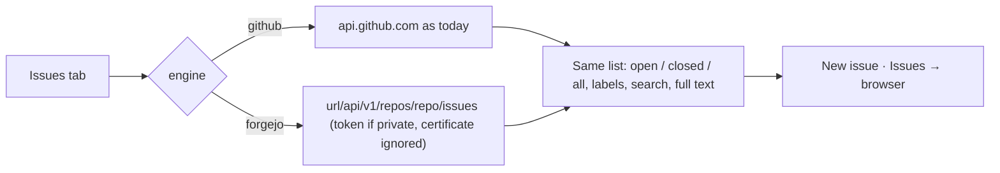

# Plan: Forgejo in the issues feature

**Ready 2 Deploy** (approved by the maintainer 2026-11-23)

## 1) Name

Forgejo in the issues feature (self-hosted bug tracker)

## 2) Planned release version

1.0.1 (all remaining plans in one version — maintainer's decision 2026-11-25; built from 27 Nov, released when everything is built and the beta test is OK)

## 3) Feasible? Checked per function, with the result

Checked against a real Forgejo 17.0.2 (latest release, Docker), reached by its network address.
Check: `docs/plans/checks/forgejo-check.js` — GitHub Actions "Plan checks", plan = forgejo (run 45141785291).

- Forgejo reached by its network address — **OK**
- List issues — open, closed, all — without pull requests — **OK**
- Every field the tab shows: number, title, state, author, labels with colour, comments, dates, full text, link — **OK**
- Filter by label and search — **OK**
- Private repository: without the token "not found", with the token the issues — **OK**

Checked: 5 · Failed: 0 · Unchecked: 0

## 4) Description

The issues feature (`issue`) gets an `engine:` setting, like the Chat: `github` (default, as today) or `forgejo` — a
self-hosted bug tracker. For Forgejo, `url:` says where the server is (same PC or in the network); a private repository
needs a token, kept as a secret. The tab works the same as today: list, filter and search in the app; **New issue** and the
button **Issues** open the browser.

## 5) Open points, only about this feature

None (all answered 2026-11-23).

## 6) Decisions, only about this feature

| id | decision |
|---|---|
| 1 | Self-hosted bug tracker: **Forgejo**, built into the issues feature like the Chat: `engine: github` (default) or `forgejo`. |
| 2 | The feature is called **`issue`** — already in 1.0 (done 2026-11-23); `github_issue` and `github` keep working. |
| 3 | The functions stay as GitHub issues today: read, filter, search in the app; **New issue** and the links open the browser. |
| 4 | Version 1.0.1 (2 Dec 2026; was 1.0.2, merged 2026-11-24). |
| 5 | Forgejo: `url:` and `repo:`; the token for a private repository in `project.yaml` as a secret (`token: ${secret:forgejo-token}`). |
| 6 | Self-made HTTPS certificates are ignored. |
| 7 | The button that opens the issues in the browser is called **Issues** (both engines; done in 1.0). |

## 7) Risks

| id | Risk | Suggestion |
|---|---|---|
| 1 | The links to issues come from Forgejo's own address setting (ROOT_URL); if it is wrong, the links point to the wrong place. | Wiki note: set the address correctly in Forgejo. |
| 2 | Ignoring certificates: someone in the network could pretend to be the server. | Wiki note: only in your own network. |
| 3 | Forgejo changes (now version 17). | Run the plan check again against the newest Forgejo before the release. |

## 8) Detail workflow

### 8a) Flow



### 8b) The YAML file

```yaml
issue:
  engine: forgejo                     # github (default) or forgejo
  url: https://192.168.1.60:3000      # only for forgejo
  repo: team/workspace
  token: ${secret:forgejo-token}      # only for a private repository
```

### 8c) How it is done

| id | desc |
|---|---|
| 1 | The issues feature reads `engine:`, `url:`, `token:` (decisions 1, 5). |
| 2 | With `engine: forgejo` the app reads `/api/v1/repos/<repo>/issues` from `url:` (state, type=issues, pages of 50), with the same fields as from GitHub; certificates ignored (decision 6); clear messages when not reachable / not found. |
| 3 | The tab works as today; **New issue** and **Issues** open the Forgejo pages (decisions 3, 7). |
| 4 | Automatic tests against a fake Forgejo (contract tests); the plan check again before the release (risk 3). |
| 5 | Wiki page "Issues": *What you need* per engine, the settings, the notes on the server address and the network; DESIGN.md, REQUIREMENTS.md, release notes of 1.0.1. |
