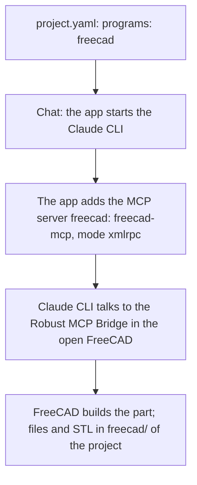

# Plan: FreeCAD

**Released in 1.0.1** (26 Nov 2026) · was **Ready 2 Deploy**


## 1) Name

FreeCAD

## 2) Planned release version

1.0.1 (all remaining plans in one version — maintainer's decision 2026-11-25; built from 27 Nov, released 5 days after the complete beta, or once 5 days later if a bug is reported in the test days)

## 3) Feasible? Checked per function, with the result

| part | desc | state | suggestion |
|---|---|---|---|
| Project | MCP FreeCAD is connected in a project | not checked — no checks for MCPs (decision 5) | — |
| FreeCAD | the Claude CLI builds parts in FreeCAD through MCP and looks at the result | not checked — no checks for MCPs (decision 5) | — |

Checked: 0 · Unchecked: 2 (no checks for MCPs, decision 5) · Failed: 0

## 4) Description

Like the other MCPs: in a project, MCP FreeCAD is connected. Someone writes in the chat, e.g. "Build me a mounting plate 80×40 mm
with four M4 holes in FreeCAD and export it as STL" (the example sentence is Claude's), and the Claude CLI does it in FreeCAD
through MCP. The app itself doesn't need to show feedback.

## 5) Open points, only about this feature

None.

## 6) Decisions, only about this feature

| id | decision |
|---|---|
| 1 | The name of an MCP is the name of the program it uses: "FreeCAD". |
| 2 | For MCPs, the existing solution is used if possible: **FreeCAD Robust MCP** (workbench in FreeCAD + MCP server `freecad-mcp`; Apache-2.0; https://github.com/spkane/freecad-addon-robust-mcp-server) — chosen by the maintainer 2026-11-20. |
| 3 | No test phase for the MCP; instead a wiki article: what is needed and how to connect FreeCAD and the app. |
| 4 | Switched on per project in `project.yaml`: `programs:` with `freecad` in it. |
| 5 | For MCPs only: no checks in point 3 and no test phase; an MCP plan can be Ready 2 Deploy without checks (2026-11-20). |
| 6 | Switching on in the app: project settings (gear) → section "MCP" with a checkbox per program, as in the [approved screen](img/mcp-settings.png); ticking writes `programs:` in `project.yaml`. |
| 7 | No own beta for an MCP: it goes out with the release of its version (2026-11-20). |
| 8 | Requirement: the current stable FreeCAD (freecad.org says 1.1.3 on 2026-11-20; Robust MCP needs at least 1.0.2 and recommends 1.1.4+), Python 3.11+. The maintainer uses no FreeCAD yet. |
| 9 | Every result of the MCP is saved in the Workspace project (its folder) — for all MCPs (2026-11-20). |
| 10 | How: the app tells Claude in every chat with this MCP to keep the FreeCAD files (`.FCStd`) and exports in the folder `freecad/` of the project (approved 2026-11-20). |
| 11 | The key is `programs:` (not `mcp:`, which is already the feature "MCP" with the connections). The app treats `programs:` as a setting of the project, not as a feature (approved 2026-11-20). |

## 7) Risks

| id | risk | suggestion |
|---|---|---|
| 1 | Not checked (decision 5): whether it works is only seen when it is used. | The wiki article says what is needed and how to connect (decision 3). |
| 2 | FreeCAD Robust MCP is a community project and still "beta"; it can change or stop. | Decision 2 ("if possible"): if it stops working, a new plan. |
| 3 | Robust MCP recommends FreeCAD 1.1.4+ because older versions have known problems when opening untrusted files; freecad.org lists 1.1.3 as current. | Only open your own files until 1.1.4 is out; the wiki article names the version. |
| 4 | It can run Python inside FreeCAD and change the FreeCAD files. | The chat's permission questions stay on. |
| 5 | More to set up than the other MCPs: Python 3.11+, the workbench, a one-time pairing (`freecad-mcp --pair-bridge`), "Start MCP Bridge" in FreeCAD. | The wiki article, step by step. |

## 8) Detail workflow

### 8a) Flow diagram



### 8b) The YAML file

```yaml
programs:
  - freecad
```

### 8c) How it is done

| id | desc |
|---|---|
| 1 | The app reads `programs:` from `project.yaml` (a list of names). |
| 1a | `programs:` is a setting of the project, not a feature: added to the project settings keys in `rust/crates/pw-core/src/workspace.rs` (META_KEYS), so it shows no tab (decision 11). |
| 1b | Project settings (gear): section "MCP" with a checkbox per known program (Blender, Unity, Unreal, Godot, OpenSCAD, FreeCAD) — ticking adds or removes the name in `programs:` (decision 6). |
| 2 | Known MCPs in the app: `freecad` → command `freecad-mcp` with `FREECAD_MODE=xmlrpc` (decision 2). Unknown names are ignored with a note in the chat. |
| 3 | `rust/crates/pw-server/src/chat.rs`: when a chat starts the Claude CLI, the known MCPs of the project are added to `--mcp-config`. |
| 3b | Same place: a note for Claude in the chat — keep the FreeCAD files (`.FCStd`) and exports in the folder `freecad/` of the project (decision 10); the app creates the folder. |
| 4 | **Required** — wiki article "MCP: FreeCAD" (decision 3); FreeCAD is only released with it: what is needed (FreeCAD, Python 3.11+, `pip install freecad-robust-mcp`, the Robust MCP Bridge workbench), how to connect (pair once with `freecad-mcp --pair-bridge`, in FreeCAD: Robust MCP Bridge → Start MCP Bridge, tick FreeCAD in the project settings), what to write in the chat. Done when: the article is in `docs/wiki/` and linked in the sidebar. |
| 5 | Docs: DESIGN.md, REQUIREMENTS.md (→ wiki "Requirements"), release notes `docs/releases/v1.0.1.md`. |
| 6 | No own beta (decision 7): goes out with the release 1.0.1, with your OK. |
