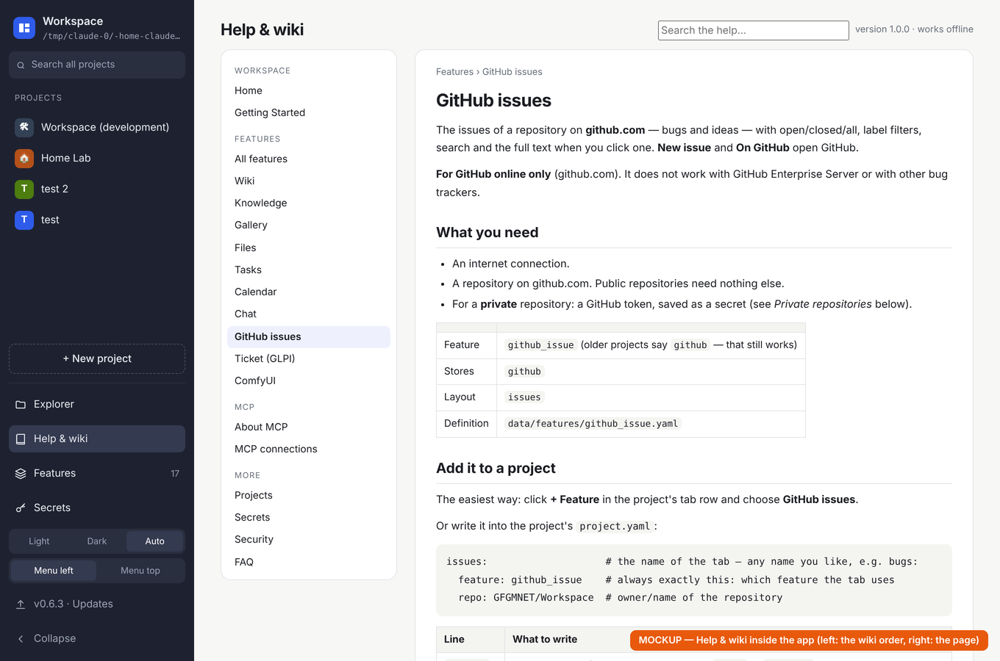
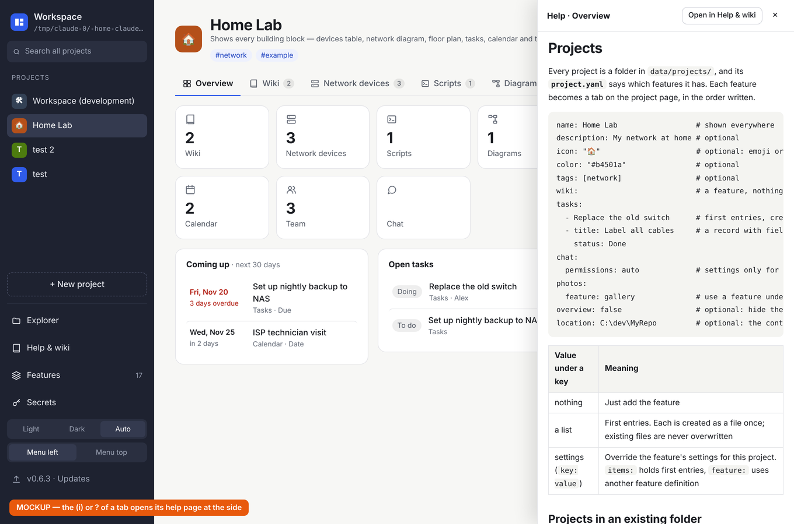
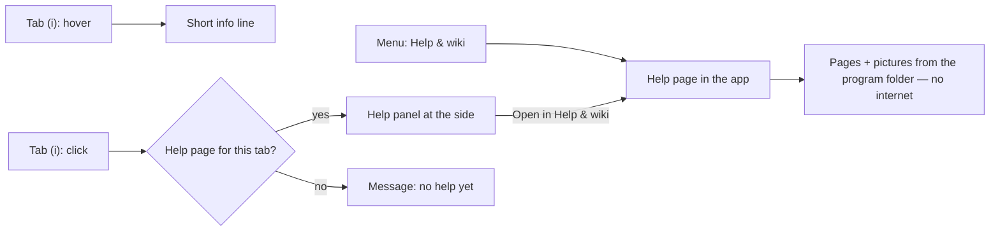

# Plan: Help & wiki inside the app

**Ready 2 Deploy** (approved by the maintainer 2026-11-23)

## 1) Name

Help & wiki inside the app

## 2) Planned release version

1.2.2 — 27 Dec 2026 (release every 5 days after 1.0, decided 2026-11-23)

## 3) Feasible? Checked per function, with the result

Checked with the real wiki pages (docs/wiki + docs/wiki-next, as after 1.0) and the app's own page display, with the
internet switched off — Chromium and WebKit on Linux, Edge (= WebView2) on Windows.
Check: `docs/plans/checks/help-check.js` — GitHub Actions "Plan checks", plan = help (run 45140078195).

- The pages can come with the program — all 37 pages and 9 pictures are in the repository (about 1 MB) — **OK**
- Help page: the wiki order on the left (36 entries), the page on the right — **OK**
- Links between wiki pages open inside the app — **OK**
- Pictures shown with no internet — **OK**
- Search — "GLPI" finds Ticket, Features, Home … — **OK**
- (i): hover shows the short info line, it goes away, a click opens the help panel — **OK**
- No errors in the three browser engines — **OK**

Checked: 9 · Failed: 0 · Unchecked: 0

## 4) Description

"Help & wiki" in the menu opens the wiki **inside the app**: on the left the wiki order (Home, Getting Started, Features,
MCP, More), on the right the page, with a search at the top. The wiki works **without an internet connection** — the pages
and pictures come with the program and match the installed version. On every tab, **hovering over the (i)** shows the short
info line as today; **clicking it** opens that tab's help page in a panel at the side, with **Open in Help & wiki**. A tab
without a help page shows a message. The wiki on GitHub stays as well.

## 5) Open points, only about this feature

None (all answered 2026-11-23).

## 6) Decisions, only about this feature

| id | decision |
|---|---|
| 1 | Both combined: a full help page in the app and a help panel at the side of each tab. |
| 2 | Version 1.2.2 (27 Dec 2026 under the 5-day release rule). |
| 3 | The GitHub wiki stays. |
| 4 | (i): hover shows the short info line as today, a click opens the help panel. |
| 5 | Only for the PC (Windows, Linux) — no tablet or phone. |
| 6 | Search in the help. |
| 7 | The new wiki works without an internet connection (pages, pictures, search, panel come with the program). Links to websites stay as they are. |
| 8 | A tab without a help page shows a message (e.g. "There is no help for this feature yet"). |
| 9 | No "Online on GitHub" link on the help page. |

## 7) Risks

| id | Risk | Suggestion |
|---|---|---|
| 1 | The wiki in the app and on GitHub could drift apart. | Both are made from the same files (`docs/wiki`) at every release. |
| 2 | The download grows by about 1 MB (pictures). | Accept. |
| 3 | New help text only comes with an update. | That is intended: the help matches the installed version. |

## 8) Detail workflow

### 8a) Flow

### 8b) The YAML file

Nothing to set — the help needs no setting.

### 8c) How it is done

| id | desc |
|---|---|
| 1 | The release build puts the wiki pages and their pictures into the program folder, made from `docs/wiki` like the GitHub wiki (decision 7, risk 1). |
| 2 | Help page: the wiki order on the left from `_Sidebar.md`, the page on the right, links between pages stay in the app, search at the top (decisions 1, 6). |
| 3 | "Help & wiki" in the menu opens the help page in the app (decision 1). |
| 4 | (i) on every tab: hover shows the info line, a click opens the panel with the tab's page, or the message when there is none; **Open in Help & wiki** (decisions 4, 8). |
| 5 | Automatic tests: every link and picture of the help is found; the page and the panel open. |
| 6 | Docs: wiki Home (help is built into the app), DESIGN.md, REQUIREMENTS.md, release notes of 1.2.2. |
