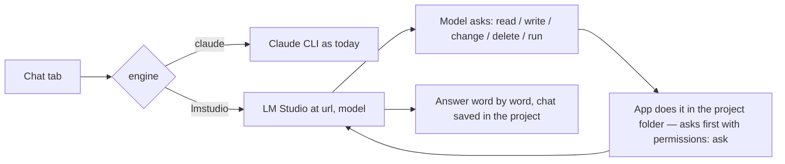

# Plan: LM Studio in the Chat

**Ready 2 Deploy** (approved by the maintainer 2026-11-23)

## 1) Name

LM Studio in the Chat

## 2) Planned release version

1.0.1 (all remaining plans in one version — maintainer's decision 2026-11-25; built from 27 Nov, released when everything is built and the beta test is OK)

## 3) Feasible? Checked per function, with the result

Checked against a real LM Studio (llmster 0.1.1, without a screen) with the model Qwen3 1.7B, on the processor, on Linux;
the app's file tools also on Windows (with the same tool calls the model made). No Claude CLI installed.
Check: `docs/plans/checks/lmstudio-check.js` — GitHub Actions "Plan checks", plan = lmstudio (runs 45137263750, 45137989467).

- LM Studio reached by its network address (`url:`) — **OK**
- The model from `project.yaml` (`model:`) is in LM Studio — **OK**
- The answer comes word by word, like the Claude chat — **OK**
- Read a file — **OK**
- Create a file — **OK**
- Change a file — **OK**
- Delete a file — **OK**
- Run a command — Linux and Windows (cmd) — **OK**
- A path outside the project folder is refused — Linux and Windows — **OK**
- No Claude CLI needed for any of this — **OK**

Checked: 10 · Failed: 0 · Unchecked: 0

## 4) Description

The **Chat** tab gets a setting that decides who answers: `engine: claude` (or no setting) uses Claude CLI as today;
`engine: lmstudio` uses a model in LM Studio — on the same PC or in the network — with `url:` and `model:`. For LM Studio
the only requirement is LM Studio, not Claude CLI. Both have the same rights in the project: read, create, change and delete
files, and run commands; the Chat's `permissions:` setting works the same for both.

## 5) Open points, only about this feature

None (all answered 2026-11-23).

## 6) Decisions, only about this feature

| id | decision |
|---|---|
| 1 | The Chat feature gets `engine:` — `claude` (default) or `lmstudio`; `url:` and `model:` only for lmstudio. |
| 2 | Requirement: Claude → Claude CLI; LM Studio → only LM Studio. |
| 3 | Both have the same rights: read, create, change, delete files, run commands. |
| 4 | `feature: chat` is not needed when the key is `chat:`. |
| 5 | Version 1.0.1. |
| 6 | `permissions:` (`ask` / `auto` / `read-only`) works for LM Studio as for Claude (Allow · Always allow in this chat · Don't allow). |
| 7 | Skills and MCP connections for LM Studio: later, not in 1.0.1. |
| 8 | `model:` keeps its name: with `engine: claude` the Claude model (e.g. `sonnet`), with `engine: lmstudio` the LM Studio model. |
| 9 | If LM Studio cannot be reached or the model is not loaded, a clear message appears in the chat. |

## 7) Risks

| id | Risk | Suggestion |
|---|---|---|
| 1 | Small models sometimes don't use the tools (first check run: the model did not read the file). | Wiki: recommend models with tool support (hammer symbol in LM Studio), e.g. Qwen Coder. |
| 2 | Running commands is powerful. | `permissions: ask` asks first (decision 6). |
| 3 | LM Studio has no password in the network. | Wiki note: only in your own network. |
| 4 | LM Studio without a screen (llmster) is still 0.x and may change. | Run the plan check again before the release. |
| 5 | Slow on weak PCs. | Wiki note. |

## 8) Detail workflow

### 8a) Flow



### 8b) The YAML file

```yaml
chat:
  engine: lmstudio                # claude (default) or lmstudio
  url: http://127.0.0.1:1234      # only for lmstudio
  model: qwen/qwen3-coder-30b     # only for lmstudio: the LM Studio model
  permissions: ask                # as today
```

### 8c) How it is done

| id | desc |
|---|---|
| 1 | Chat feature reads `engine:`, `url:`, `model:` (decisions 1, 4, 8); clear message when LM Studio is not reachable or the model not loaded (decision 9). |
| 2 | The app's own file tools — read, create, change, delete, list, run — only inside the project folder (decision 3). |
| 3 | Chat loop with LM Studio: send, stream the answer, run the tools the model asks for, send the results back, until done. |
| 4 | `permissions:` for LM Studio as for Claude: ask / auto / read-only, with Allow · Always allow · Don't allow (decision 6). |
| 5 | Chats saved in the project, as today. |
| 6 | Automatic tests against a fake LM Studio (contract tests). Before the release: the plan check again against the newest LM Studio (risk 4). |
| 7 | Wiki page Chat: *What you need* per engine (Claude CLI — or LM Studio with a tool-capable model), the setting, the network note; DESIGN.md, REQUIREMENTS.md, release notes of 1.0.1. |
