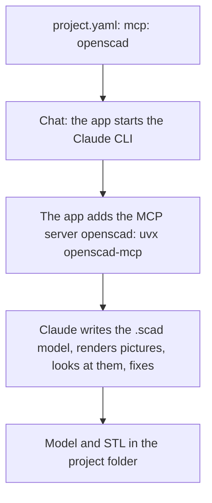

# Plan: OpenSCAD

**Ready 2 Deploy**


## 1) Name

OpenSCAD

## 2) Planned release version

1.2.5

## 3) Feasible? Checked per function, with the result

| part | desc | state | suggestion |
|---|---|---|---|
| Project | MCP OpenSCAD is connected in a project | not checked — no checks for MCPs (decision 5) | — |
| OpenSCAD | the Claude CLI builds models in OpenSCAD through MCP and looks at the result | not checked — no checks for MCPs (decision 5) | — |

Checked: 0 · Unchecked: 2 (no checks for MCPs, decision 5) · Failed: 0

## 4) Description

Use the Claude CLI for OpenSCAD. In a project, MCP OpenSCAD is connected; the MCP lets Claude see what it built (pictures of the
model) and fix it — chosen by the maintainer over "no MCP" for that reason. E.g. "Build me a wall bracket for a 30 mm pipe in
OpenSCAD, ready for 3D printing" (the example sentence is Claude's). The app itself doesn't need to show feedback.

## 5) Open points, only about this feature

None.

## 6) Decisions, only about this feature

| id | decision |
|---|---|
| 1 | The name of an MCP is the name of the program it uses: "OpenSCAD". |
| 2 | For MCPs, the existing solution is used if possible: **openscad-mcp** (uses the OpenSCAD on the PC; free, MIT; started with `uvx openscad-mcp`) — chosen by the maintainer 2026-11-20. |
| 3 | No test phase for the MCP; instead a wiki article: what is needed and how to connect OpenSCAD and the app. |
| 4 | Switched on per project in `project.yaml`: `mcp:` with `openscad` in it. |
| 5 | For MCPs only: no checks in point 3 and no test phase; an MCP plan can be Ready 2 Deploy without checks (2026-11-20). |
| 6 | Switching on in the app: project settings (gear) → section "MCP" with a checkbox per program, as in the [approved screen](img/mcp-settings.png); ticking writes `mcp:` in `project.yaml`. |
| 7 | No own beta for an MCP: it goes out with the release of its version (2026-11-20). |
| 8 | Requirement: OpenSCAD 2021.01 or newer, and `uv`. |
| 9 | Every result of the MCP is saved in the Workspace project (its folder) — for all MCPs (2026-11-20). |
| 10 | How: the app tells Claude in every chat with this MCP to keep the `.scad` models and STL files in the folder `openscad/` of the project (approved 2026-11-20). |

## 7) Risks

| id | risk | suggestion |
|---|---|---|
| 1 | Not checked (decision 5): whether it works is only seen when it is used. | The wiki article says what is needed and how to connect (decision 3). |
| 2 | openscad-mcp is a community project (no official OpenSCAD MCP exists); it can change or stop. | Decision 2 ("if possible"): if it stops working, a new plan. |
| 3 | If OpenSCAD is not found on the PC, the OpenSCAD tools answer with an error. | The wiki article says how to set `OPENSCAD_PATH`. |

## 8) Detail workflow

### 8a) Flow diagram



### 8b) The YAML file

```yaml
mcp:
  - openscad
```

### 8c) How it is done

| id | desc |
|---|---|
| 1 | The app reads `mcp:` from `project.yaml` (a list of names). |
| 1b | Project settings (gear): section "MCP" with a checkbox per known program (Blender, Unity, Unreal, Godot, OpenSCAD) — ticking adds or removes the name in `mcp:` (decision 6). |
| 2 | Known MCPs in the app: `openscad` → command `uvx openscad-mcp` (decision 2). Unknown names are ignored with a note in the chat. |
| 3 | `rust/crates/pw-server/src/chat.rs`: when a chat starts the Claude CLI, the known MCPs of the project are added to `--mcp-config`. |
| 3b | Same place: a note for Claude in the chat — keep the `.scad` models and STL files in the folder `openscad/` of the project (decision 10); the app creates the folder. |
| 4 | **Required** — wiki article "MCP: OpenSCAD" (decision 3); OpenSCAD is only released with it: what is needed (OpenSCAD 2021.01 or newer, `uv`), how to connect (tick OpenSCAD in the project settings; `OPENSCAD_PATH` if OpenSCAD is not found), what to write in the chat. Done when: the article is in `docs/wiki/` and linked in the sidebar. |
| 5 | Docs: DESIGN.md, REQUIREMENTS.md (→ wiki "Requirements"), release notes `docs/releases/v1.2.5.md`. |
| 6 | No own beta (decision 7): goes out with the release 1.2.5, with your OK. |
