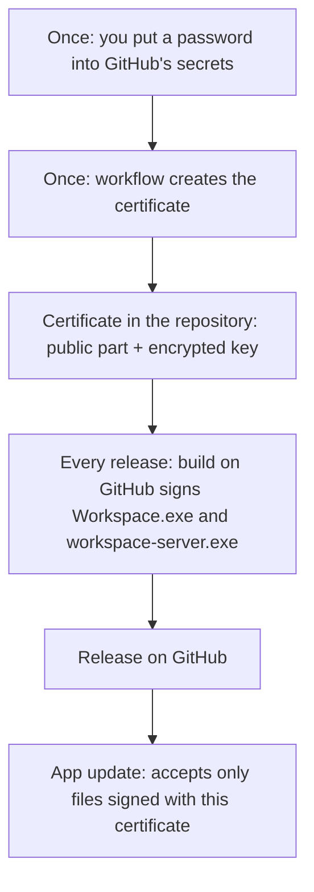

# Plan: Signing with own certificate

**Ready 2 Deploy**

## 1) Name

Signing with own certificate

## 2) Planned release version

0.9.1

## 3) Feasible? Checked per function, with the result

| part | desc | state | suggestion |
|---|---|---|---|
| Certificate | create an own certificate and store it in the repository (private key encrypted) | ✅ checked, Windows | — |
| Windows | the build on GitHub signs `Workspace.exe` and `workspace-server.exe` with it | ✅ checked, Windows | — |
| Updater | the app only accepts updates signed with this certificate | ✅ checked, Windows | — |

Checked: 3 · Unchecked: 0 · Failed: 0

Check: `docs/plans/checks/signing-check.ps1` with a throwaway test certificate, run 2026-11-19 on GitHub's Windows machine:
https://github.com/GFGMNET/Workspace/actions/runs/44535006682 — certificate + encrypted key created, key cannot be opened
without the password, program signed with timestamp, updater accepts the real update and refuses a changed file, a file signed
by someone else named "Workspace", and an unsigned file. Windows says "not trusted" until the certificate is installed on the PC,
then "valid".

## 4) Description

Windows software is signed with an own certificate. The certificate is stored in the repository.

## 5) Open points, only about this feature

None.

## 6) Decisions, only about this feature

| id | decision |
|---|---|
| 1 | Own (self-made) certificate instead of a bought one (2026-11-19). |
| 2 | The certificate is in the repository; its private key is encrypted, the password is in GitHub's secrets. |

## 7) Risks

| id | risk | suggestion |
|---|---|---|
| 1 | Windows SmartScreen and virus scanners still warn, unless the certificate is installed on the PC (checked: "not trusted" before, "valid" after installing). | The release page explains how to install the certificate. |
| 2 | If the password leaks, anyone can sign as "Workspace". | Long random password, only in GitHub's secrets. |
| 3 | The certificate is made for 10 years; after that a new one is needed. | The new one is announced by an update that is still signed with the old one. |

## 8) Detail workflow

### 8a) Flow diagram

### 8b) The YAML file

No change.

### 8c) How it is done

| id | desc |
|---|---|
| 1 | You: create the secret `SIGNING_PASSWORD` in GitHub (Settings → Secrets and variables → Actions) with a long random password, e.g. from a password manager. I give you the exact clicks then. |
| 2 | New workflow `.github/workflows/signing-cert.yml`, started once by hand: creates the certificate (name "Workspace", 10 years) and stores `signing/workspace-signing.pfx` (key, encrypted) and `signing/workspace-signing.cer` (public part) in the repository. It refuses to run if a certificate is already there. |
| 3 | `build-rust.yml`, Windows: signs `Workspace.exe` and `workspace-server.exe` (with timestamp) before packing; if signing fails, there is no release. |
| 4 | `rust/crates/pw-server/src/updater.rs`, `check_signature`: accepts a new program only if it is signed with exactly this certificate (its fingerprint is built into the app) and the file is unchanged; "SignPath Foundation" is removed. |
| 5 | `app/lib/updater.js` (0.x → 1.0 move): the same check. |
| 6 | Release page: the SignPath text is removed; it explains how to install the certificate and shows its fingerprint. |
| 7 | Automatic test: `docs/plans/checks/signing-check.ps1` runs in `rust.yml` on Windows. Done when: green. |
| 8 | Docs: RELEASE-TRUST.md, DESIGN.md, REQUIREMENTS.md, wiki, release notes `docs/releases/v0.9.1.md`. |
| 9 | You test it: install 0.9.1; an update is accepted; Windows shows "Workspace" as publisher after installing the certificate. |
| 10 | Release 0.9.1 with your OK. |
