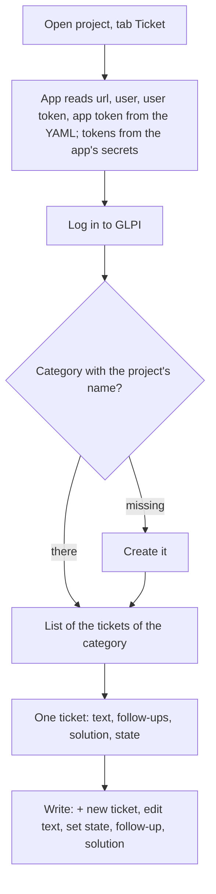

# Plan: Ticketsystem

**Ready 2 Deploy** · **built** (steps 1–6, tests green on Windows + Linux: https://github.com/GFGMNET/Workspace/actions/runs/44574025545) · **tested OK by the maintainer 2026-11-20 with 0.9.1.2** (step 7, incl. the fix for #79) · **released in 1.0.0** (26 Nov 2026)

## 1) Name

Ticketsystem

## 2) Planned release version

1.0 (back from 1.1: Ready 2 Deploy, maintainer's decision 2026-11-19)

## 3) Feasible? Checked per function, with the result

| part | desc | state | suggestion |
|---|---|---|---|
| Tickets | read: list of the tickets of the category, one ticket | ✅ checked, Windows + Linux | — |
| Tickets | write: create a ticket in the category | ✅ checked, Windows + Linux | — |
| Tickets | write: edit a ticket's text | ✅ checked, Windows + Linux | — |
| Tickets | write: set the state of a ticket | ✅ checked, Windows + Linux | — |
| Tickets | write: add a solution to a ticket, read it | ✅ checked, Windows + Linux | — |
| Follow-ups | read: follow-ups of a ticket | ✅ checked, Windows + Linux | — |
| Follow-ups | write: add a follow-up to a ticket | ✅ checked, Windows + Linux | — |
| Category | create the category with the project's name if it does not exist | ✅ checked, Windows + Linux | — |
| Category | only tickets of the category with the project's name | ✅ checked, Windows + Linux | — |

Checked: 9 · Unchecked: 0 · Failed: 0

Check: `docs/plans/checks/glpi-check.js` against the GLPI test environment, run 2026-11-19 from GitHub, Windows + Linux:
https://github.com/GFGMNET/Workspace/actions/runs/44555846873 (seen there: after a solution GLPI sets the ticket to "solved" by itself).

## 4) Description

Tickets and comments (GLPI follow-ups) from GLPI, filtered by category (the category is the project name). Read and write,
including editing the text, setting the state of a ticket and the solution.

## 5) Open points, only about this feature

None.

## 6) Decisions, only about this feature

| id | decision |
|---|---|
| 1 | GLPI 11 only (osTicket dropped). |
| 2 | Filter by category; the category is the project name (changed by the maintainer 2026-11-19 from entity: entities could not be created through the API on the test environment). |
| 3 | The checks run against the maintainer's GLPI test environment (`ticket.bbdi42.de`). |
| 4 | Only tickets — no GLPI changes (changed by the maintainer 2026-11-19). |
| 5 | Comments are GLPI follow-ups. |
| 6 | Writing includes editing a ticket's text. |
| 7 | Login: for the test the account Hermes; in the live environment the account is set in the YAML file (the token as `${secret:…}`, project rule: no secrets in project files). |
| 8 | The tab is called "Ticket". |
| 9 | The screens as in the approved screenshots: [list](img/glpi-list.png), [one ticket](img/glpi-ticket.png). |
| 10 | New ticket: a "+" button with the help text "New Ticket"; no text line above the list. |
| 11 | If the category with the project's name does not exist in GLPI, the app creates it. |
| 12 | What GLPI needs for this is described in the wiki: API client (allowed IP address, app token) and the rights of the account's profile (incl. creating categories). |
| 13 | The YAML has the user token and the app token, both from the app's secrets. |
| 14 | If a category with the project's name is already used in GLPI for other tickets, those tickets show up in the project too — OK. |

## 7) Risks

| id | risk | suggestion |
|---|---|---|
| 1 | Without the GLPI setup nothing works (seen in the checks): the API client must allow the address the requests come from, the app token must match, and the profile needs the rights incl. creating categories. | Decision 12: described in the wiki. |
| 2 | After a solution, GLPI sets the ticket to "solved" by itself (seen in the check). | The tab shows the state GLPI reports. |
| 3 | The API token of the test environment was written in the chat. | Create a new token in GLPI after the checks and replace the secret `GLPI_TOKEN`. |

## 8) Detail workflow

### 8a) Flow diagram



### 8b) The YAML file

```yaml
ticket:
  feature: ticketsystem
  url: https://ticket.example.com
  user: hermes
  user_token: ${secret:glpi-user-token} # GLPI user API token, from the app's secrets, never as text
  app_token: ${secret:glpi-app-token}   # GLPI app token of the API client, from the app's secrets
```

### 8c) How it is done

| id | desc |
|---|---|
| 1 | New feature file `app/starter/features/ticketsystem.yaml`: name "Ticket" (decision 8), layout `tickets`. |
| 2 | New file `rust/crates/pw-server/src/glpi.rs`, the same GLPI calls as the check: log in, find the category with the project's name or create it (decisions 2, 11), list of its tickets, one ticket, follow-ups, solution; write: create a ticket in the category, edit the text, set the state, add a follow-up, add a solution. User token and app token only from the secrets (decisions 7, 13). |
| 3 | New addresses in the app server for these (`/api/projects/{p}/f/{f}/tickets/...`), only for 127.0.0.1 like all others. |
| 4 | New screen `VIEWS.tickets` in `app/public/views.js`, as in the approved screenshots, with the "+" button and its help text (decisions 9, 10). |
| 5 | Automatic tests `tests/contract/tickets.test.js` against a small fake GLPI (like the GitHub tests), run by `rust.yml` on Windows and Linux. Done when: all green. |
| 6 | Docs: wiki page "Ticket" with the GLPI setup (decision 12), REQUIREMENTS.md (→ wiki "Requirements"), DESIGN.md, release notes `docs/releases/v1.0.0.md`. |
| 7 | You test it with your GLPI test environment. Done when: list, one ticket, + new ticket, edit, state, follow-up, solution work in the tab. |
| 8 | Release with 1.0 (26 November, after a week without a new bug). |
