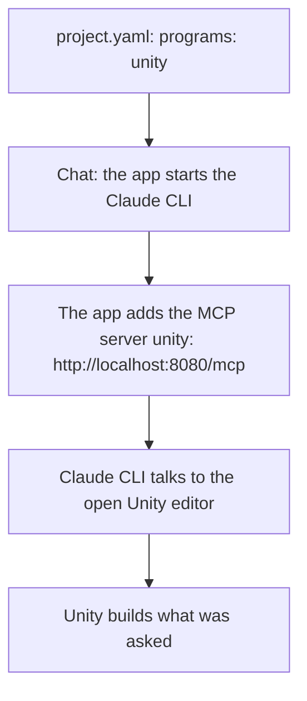

# Plan: Unity

**Ready 2 Deploy**


## 1) Name

Unity

## 2) Planned release version

1.0.1 (all remaining plans in one version — maintainer's decision 2026-11-25; built from 27 Nov, released when everything is built and the beta test is OK)

## 3) Feasible? Checked per function, with the result

| part | desc | state | suggestion |
|---|---|---|---|
| Project | MCP Unity is connected in a project | not checked — no checks for MCPs (decision 5) | — |
| Unity | the Claude CLI builds things in Unity through MCP | not checked — no checks for MCPs (decision 5) | — |

Checked: 0 · Unchecked: 2 (no checks for MCPs, decision 5) · Failed: 0

## 4) Description

In a project, MCP Unity is connected. Someone writes in the chat, e.g. "Build me a small medieval village scene in Unity, use Low Poly", and the Claude CLI does it in
Unity through MCP. The app itself doesn't need to show feedback. (Same as the Blender plan; the example sentence is Claude's.)

## 5) Open points, only about this feature

None.

## 6) Decisions, only about this feature

| id | decision |
|---|---|
| 1 | The name of an MCP is the name of the program it uses: "Unity". |
| 2 | For MCPs, the existing solution is used if possible: "MCP for Unity" (Unity package + MCP server, free, MIT, https://github.com/CoplayDev/unity-mcp; not from Unity Technologies). |
| 3 | No test phase for the MCP; instead a wiki article: what is needed and how to connect Unity and the app. |
| 4 | Switched on per project in `project.yaml`: `programs:` with `unity` in it. |
| 5 | For MCPs only: no checks in point 3 and no test phase; an MCP plan can be Ready 2 Deploy without checks (2026-11-20). |
| 6 | Switching on in the app: project settings (gear) → section "MCP" with a checkbox per program, as in the [approved screen](img/mcp-settings.png); ticking writes `programs:` in `project.yaml`. |
| 7 | No own beta for an MCP: it goes out with the release of its version (2026-11-20). |
| 9 | Every result of the MCP is saved in the Workspace project (its folder) — for all MCPs (2026-11-20). |
| 10 | How: the app tells Claude in every chat with this MCP to keep the Unity project in the folder `unity/` of the project (approved 2026-11-20). |
| 11 | The key is `programs:` (not `mcp:`, which is already the feature "MCP" with the connections). The app treats `programs:` as a setting of the project, not as a feature (approved 2026-11-20). |

## 7) Risks

| id | risk | suggestion |
|---|---|---|
| 1 | Not checked (decision 5): whether it works is only seen when it is used. | The wiki article says what is needed and how to connect (decision 3). |
| 2 | MCP for Unity lets Claude change scenes, scripts and assets of the Unity project. | The chat's permission questions stay on. |
| 3 | MCP for Unity is someone else's project (not Unity Technologies); it can change or stop. | Decision 2 ("if possible"): if it stops working, a new plan. |
| 4 | Unity has to be open with the MCP for Unity server started, plus Python 3.10+ and `uv`; otherwise the Unity tools answer with an error. | The wiki article. |

## 8) Detail workflow

### 8a) Flow diagram



### 8b) The YAML file

```yaml
programs:
  - unity
```

### 8c) How it is done

| id | desc |
|---|---|
| 1 | The app reads `programs:` from `project.yaml` (a list of names). |
| 1a | `programs:` is a setting of the project, not a feature: added to the project settings keys in `rust/crates/pw-core/src/workspace.rs` (META_KEYS), so it shows no tab (decision 11). |
| 1b | Project settings (gear): section "MCP" with a checkbox per known program (Blender, Unity, Unreal) — ticking adds or removes the name in `programs:` (decision 6). |
| 2 | Known MCPs in the app: `unity` → MCP for Unity's server at `http://localhost:8080/mcp` (its default, started from Unity: Window → MCP for Unity) (decision 2). Unknown names are ignored with a note in the chat. |
| 3 | `rust/crates/pw-server/src/chat.rs`: when a chat starts the Claude CLI, the known MCPs of the project are added to `--mcp-config` (like the project's `.mcp.json` today). |
| 3b | Same place: a note for Claude in the chat — keep the Unity project in the folder `unity/` of the project (decision 10); the app creates the folder. |
| 4 | **Required** — wiki article "MCP: Unity" (decision 3); Unity is only released with it: what is needed (Unity 2021.3 or newer, the package from `https://github.com/CoplayDev/unity-mcp.git?path=/MCPForUnity#main`, Python 3.10+, `uv`), how to connect (install the package, start the server in Window → MCP for Unity, tick Unity in the project settings), what to write in the chat. Done when: the article is in `docs/wiki/` and linked in the sidebar. |
| 5 | Docs: DESIGN.md, REQUIREMENTS.md (→ wiki "Requirements"), release notes `docs/releases/v1.0.1.md`. |
| 6 | No own beta (decision 7): goes out with the release 1.0.1, with your OK. |
