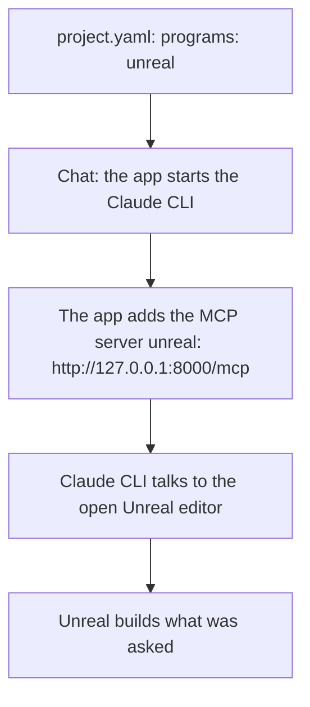

# Plan: Unreal

**Ready 2 Deploy**


## 1) Name

Unreal

## 2) Planned release version

1.0.2 (was 1.2; 1.1 and 1.2 merged into 1.0.2 by the maintainer 2026-11-24)

## 3) Feasible? Checked per function, with the result

| part | desc | state | suggestion |
|---|---|---|---|
| Project | MCP Unreal is connected in a project | not checked — no checks for MCPs (decision 5) | — |
| Unreal | the Claude CLI builds things in Unreal through MCP | not checked — no checks for MCPs (decision 5) | — |

Checked: 0 · Unchecked: 2 (no checks for MCPs, decision 5) · Failed: 0

## 4) Description

In a project, MCP Unreal is connected. Someone writes in the chat, e.g. "Build me a medieval market square in Unreal, use Low Poly", and the Claude CLI does it in
Unreal through MCP. The app itself doesn't need to show feedback. (Same as the Blender plan; the example sentence is Claude's.)

## 5) Open points, only about this feature

None.

## 6) Decisions, only about this feature

| id | decision |
|---|---|
| 1 | The name of an MCP is the name of the program it uses: "Unreal". |
| 2 | For MCPs, the existing solution is used if possible: "Unreal MCP", Epic's own plugin built into Unreal Editor (`ModelContextProtocol`, https://dev.epicgames.com/documentation/unreal-engine/unreal-mcp-in-unreal-editor). |
| 3 | No test phase for the MCP; instead a wiki article: what is needed and how to connect Unreal and the app. |
| 4 | Switched on per project in `project.yaml`: `programs:` with `unreal` in it. |
| 5 | For MCPs only: no checks in point 3 and no test phase; an MCP plan can be Ready 2 Deploy without checks (2026-11-20). |
| 6 | Switching on in the app: project settings (gear) → section "MCP" with a checkbox per program, as in the [approved screen](img/mcp-settings.png); ticking writes `programs:` in `project.yaml`. |
| 7 | No own beta for an MCP: it goes out with the release of its version (2026-11-20). |
| 8 | Requirement: Unreal Engine 5.8 or newer (the maintainer uses 5.8). |
| 9 | Every result of the MCP is saved in the Workspace project (its folder) — for all MCPs (2026-11-20). |
| 10 | How: the app tells Claude in every chat with this MCP to keep the Unreal project in the folder `unreal/` of the project (approved 2026-11-20). |
| 11 | The key is `programs:` (not `mcp:`, which is already the feature "MCP" with the connections). The app treats `programs:` as a setting of the project, not as a feature (approved 2026-11-20). |

## 7) Risks

| id | risk | suggestion |
|---|---|---|
| 1 | Not checked (decision 5): whether it works is only seen when it is used. | The wiki article says what is needed and how to connect (decision 3). |
| 2 | Epic marks Unreal MCP as **experimental**: it can change between Unreal versions. | Decision 8: 5.8 or newer; the wiki article names the version it was written for. |
| 3 | Unreal MCP has no login; it only accepts connections from the same PC. | Keep it on the same PC (default). |
| 4 | Unreal has to be open with the plugin on; otherwise the Unreal tools answer with an error. | The wiki article. |

## 8) Detail workflow

### 8a) Flow diagram



### 8b) The YAML file

```yaml
programs:
  - unreal
```

### 8c) How it is done

| id | desc |
|---|---|
| 1 | The app reads `programs:` from `project.yaml` (a list of names). |
| 1a | `programs:` is a setting of the project, not a feature: added to the project settings keys in `rust/crates/pw-core/src/workspace.rs` (META_KEYS), so it shows no tab (decision 11). |
| 1b | Project settings (gear): section "MCP" with a checkbox per known program (Blender, Unity, Unreal) — ticking adds or removes the name in `programs:` (decision 6). |
| 2 | Known MCPs in the app: `unreal` → Unreal MCP at `http://127.0.0.1:8000/mcp` (its default, it starts with the editor) (decision 2). Unknown names are ignored with a note in the chat. |
| 3 | `rust/crates/pw-server/src/chat.rs`: when a chat starts the Claude CLI, the known MCPs of the project are added to `--mcp-config` (like the project's `.mcp.json` today). |
| 3b | Same place: a note for Claude in the chat — keep the Unreal project in the folder `unreal/` of the project (decision 10); the app creates the folder. |
| 4 | **Required** — wiki article "MCP: Unreal" (decision 3); Unreal is only released with it: what is needed (Unreal Engine 5.8 or newer with the Unreal MCP plugin, decision 8), how to connect (Edit → Plugins → Unreal MCP on, tick Unreal in the project settings), what to write in the chat. Done when: the article is in `docs/wiki/` and linked in the sidebar. |
| 5 | Docs: DESIGN.md, REQUIREMENTS.md (→ wiki "Requirements"), release notes `docs/releases/v1.0.2.md`. |
| 6 | No own beta (decision 7): goes out with the release 1.0.2, with your OK. |
