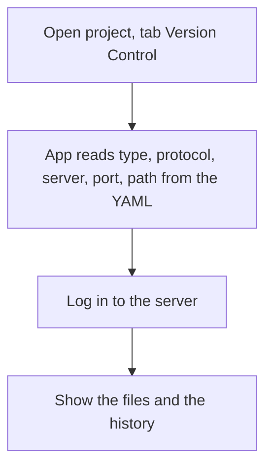

# Plan: Git/SVN integration


## 1) Name

Git/SVN integration

## 2) Planned release version

1.0.1

## 3) Feasible? Checked per function, with the result

| part | desc | state | suggestion |
|---|---|---|---|
| Git http | log in to the server | ✅ checked, Windows + Linux | — |
| Git http | see the list of files | ✅ checked, Windows + Linux | — |
| Git http | read a file | ✅ checked, Windows + Linux | — |
| Git http | see the history | ✅ checked, Windows + Linux | — |
| Git http | see the history of one file | ✅ checked, Windows + Linux | — |
| Git https | log in to the server | ✅ checked, Windows + Linux | — |
| Git https | see the list of files | ✅ checked, Windows + Linux | — |
| Git https | read a file | ✅ checked, Windows + Linux | — |
| Git https | see the history | ✅ checked, Windows + Linux | — |
| Git https | see the history of one file | ✅ checked, Windows + Linux | — |
| Git ssh | log in to the server | ✅ checked, Windows + Linux | — |
| Git ssh | see the list of files | ✅ checked, Windows + Linux | — |
| Git ssh | read a file | ✅ checked, Windows + Linux | — |
| Git ssh | see the history | ✅ checked, Windows + Linux | — |
| Git ssh | see the history of one file | ✅ checked, Windows + Linux | — |
| SVN svn | log in to the server | ✅ checked, Windows + Linux | — |
| SVN svn | see the list of files | ✅ checked, Windows + Linux | — |
| SVN svn | read a file | ✅ checked, Windows + Linux | — |
| SVN svn | see the history | ✅ checked, Windows + Linux | — |
| SVN svn | see the history of one file | ✅ checked, Windows + Linux | — |
| SVN http | log in to the server | ✅ checked, Windows + Linux | — |
| SVN http | see the list of files | ✅ checked, Windows + Linux | — |
| SVN http | read a file | ✅ checked, Windows + Linux | — |
| SVN http | see the history | ✅ checked, Windows + Linux | — |
| SVN http | see the history of one file | ✅ checked, Windows + Linux | — |
| SVN https | log in to the server | ✅ checked, Windows + Linux | — |
| SVN https | see the list of files | ✅ checked, Windows + Linux | — |
| SVN https | read a file | ✅ checked, Windows + Linux | — |
| SVN https | see the history | ✅ checked, Windows + Linux | — |
| SVN https | see the history of one file | ✅ checked, Windows + Linux | — |
| Git git:// | log in to the server | ❌ not feasible: git:// has no login, anyone can read | closed, not offered in the YAML |

Checked: 30 · Unchecked: 0 · Failed: 0 · Not feasible (closed): 1

Check: `docs/plans/checks/git-svn-read-check.sh` with own test servers and a login, run 2026-11-19 on GitHub, Windows + Linux: https://github.com/GFGMNET/Workspace/actions/runs/44509960434

## 4) Description

Read access to the files from the repository, to show them and their history, for Git and SVN.

## 5) Open points, only about this feature

| id | question |
|---|---|
| 1 | Login: stored in the app's secrets (in the YAML `user:` and `password:` / `key:` with `${secret:…}`)? |
| 2 | Git: download only the list of files and the history first, and a file's content only when the file is opened? |
| 3 | Where the downloaded Git data is kept: in the app's own folder (`data/.app/vcs/`), not in the project folder? |
| 4 | Security: switch off the Git settings that can start programs, for every command? |
| 5 | Screen: files and folders on the left, the opened file on the right, a history view, click a file → its history? |
| 6 | https with a server that has a self-made certificate: the certificate has to be installed on the PC — OK? |

## 6) Decisions, only about this feature

| id | decision |
|---|---|
| 1 | Server and port are set in the YAML file. |
| 2 | Git and SVN use a login. |
| 3 | The tab is called "Version Control". |
| 4 | The protocol is set in the YAML file. |
| 5 | The tab shows whatever folder `path` names (also for SVN). |
| 6 | The test servers for the checks (Git and SVN, with login) are set up by Claude on GitHub's Windows and Linux machines. |

## 7) Risks

| id | risk | suggestion |
|---|---|---|
| 1 | With a very big Git repository, the first download takes long. | Open point 2. |
| 2 | A server with a self-made https certificate is not trusted by the PC. | Open point 6. |

## 8) Detail workflow

### 8a) Flow diagram



### 8b) The YAML file

```yaml
version-control:
  feature: version-control
  type: git                 # git or svn
  protocol: https           # git: http, https or ssh · svn: svn, http or https
  server: 192.168.1.20
  port: 3000
  path: team/project.git    # which repository (svn: the folder that is shown)
  # login: see open point 1
```

### 8c) How it is done

Written after the open points are answered.
