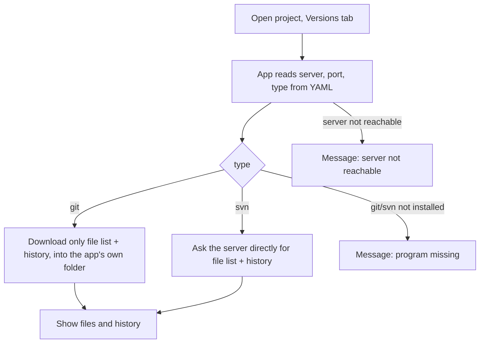

# Plan: Git/SVN integration

## 1) Name

Git/SVN integration

## 2) Planned release version

1.0.1

## 3) Feasible? Checked per function, with the result

- Git – see the files: unchecked
- Git – see the history: unchecked
- SVN – see the files: unchecked
- SVN – see the history: failed

Checked: 0 · Unchecked: 3 · Failed: 1

## 4) Description

See the files from the repository and the history, for Git and SVN.

## 5) Open points, only about this feature

| id | question |
|---|---|
| 1 | Can Git show the files of a repository on a server (IP + port)? |
| 2 | Can Git show the history of a repository on a server (IP + port)? |
| 3 | Can SVN show the files of a repository on a server (IP + port)? |
| 4 | Why did the SVN server login fail on Windows, and can SVN show the history there? |
| 5 | Which protocol: Git (http, ssh or git), SVN (svn or http)? |
| 6 | Is `path` the right way to say which repository? |
| 7 | SVN: always `trunk`, or can it be another folder? |

## 6) Decisions, only about this feature

| id | decision |
|---|---|
| 1 | Server and port are set in the YAML file. |

## 7) Risks

| id | risk | suggestion |
|---|---|---|
| 1 | 1.0.1 can only come after 1.0, and 1.0 for Windows waits for signing. | Build and check 1.0.1 now, release it together with 1.0. |
| 2 | Git cannot show files of a server repository without first downloading a copy; a big repository takes long and uses disk space. | Download only the list of files and the history, not the file contents (to be checked with open points 1 and 2). |

## 8) Detail workflow

### 8a) Flow diagram



### 8b) The YAML file

In the project, the same way as the GitHub issues today.

Git:

```yaml
versions:
  feature: versions
  type: git
  server: 192.168.1.20
  port: 3000
  path: team/project        # which repository on the server
```

SVN:

```yaml
versions:
  feature: versions
  type: svn
  server: 192.168.1.30
  port: 3690
  path: repos/project/trunk # which repository, and which folder in it
```

### 8c) How it is done

| id | desc |
|---|---|
| 1 | Check open points 1–7 on Windows and Linux. |
| 2 | Add the feature file `versions.yaml`. |
| 3 | The app reads server, port, type and path from the project's YAML. |
| 4 | Git: download only the file list and history into the app's own folder, never into the project folder. |
| 5 | SVN: get the file list and history directly from the server. |
| 6 | The tab shows the files and the history. |
| 7 | Messages for: server not reachable, git/svn not installed. |
| 8 | Automatic tests on Windows and Linux. |
| 9 | You test it. |
| 10 | Docs updated, released together with 1.0. |
