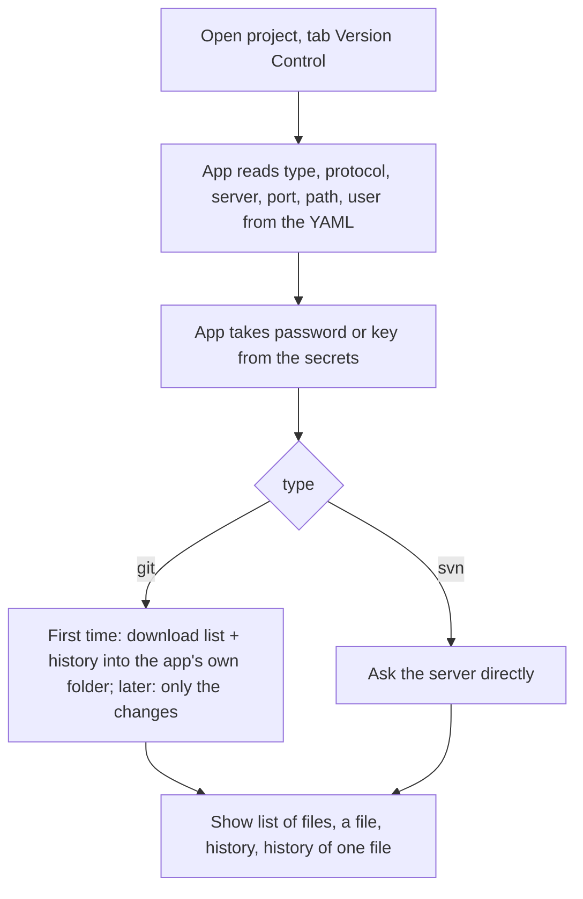

# Plan: Git/SVN integration

**Ready 2 Deploy**

## 1) Name

Git/SVN integration

## 2) Planned release version

1.0.1

## 3) Feasible? Checked per function, with the result

| part | desc | state | suggestion |
|---|---|---|---|
| Git http | log in to the server | ✅ checked, Windows + Linux | — |
| Git http | see the list of files | ✅ checked, Windows + Linux | — |
| Git http | read a file | ✅ checked, Windows + Linux | — |
| Git http | see the history | ✅ checked, Windows + Linux | — |
| Git http | see the history of one file | ✅ checked, Windows + Linux | — |
| Git https | log in to the server | ✅ checked, Windows + Linux | — |
| Git https | see the list of files | ✅ checked, Windows + Linux | — |
| Git https | read a file | ✅ checked, Windows + Linux | — |
| Git https | see the history | ✅ checked, Windows + Linux | — |
| Git https | see the history of one file | ✅ checked, Windows + Linux | — |
| Git ssh | log in to the server | ✅ checked, Windows + Linux | — |
| Git ssh | see the list of files | ✅ checked, Windows + Linux | — |
| Git ssh | read a file | ✅ checked, Windows + Linux | — |
| Git ssh | see the history | ✅ checked, Windows + Linux | — |
| Git ssh | see the history of one file | ✅ checked, Windows + Linux | — |
| SVN svn | log in to the server | ✅ checked, Windows + Linux | — |
| SVN svn | see the list of files | ✅ checked, Windows + Linux | — |
| SVN svn | read a file | ✅ checked, Windows + Linux | — |
| SVN svn | see the history | ✅ checked, Windows + Linux | — |
| SVN svn | see the history of one file | ✅ checked, Windows + Linux | — |
| SVN http | log in to the server | ✅ checked, Windows + Linux | — |
| SVN http | see the list of files | ✅ checked, Windows + Linux | — |
| SVN http | read a file | ✅ checked, Windows + Linux | — |
| SVN http | see the history | ✅ checked, Windows + Linux | — |
| SVN http | see the history of one file | ✅ checked, Windows + Linux | — |
| SVN https | log in to the server | ✅ checked, Windows + Linux | — |
| SVN https | see the list of files | ✅ checked, Windows + Linux | — |
| SVN https | read a file | ✅ checked, Windows + Linux | — |
| SVN https | see the history | ✅ checked, Windows + Linux | — |
| SVN https | see the history of one file | ✅ checked, Windows + Linux | — |
| Git git:// | log in to the server | ❌ not feasible: git:// has no login, anyone can read | closed, not offered in the YAML |

Checked: 30 · Unchecked: 0 · Failed: 0 · Not feasible (closed): 1

Check: `docs/plans/checks/git-svn-read-check.sh` with own test servers and a login (also: password/key is in no file, wrong
login is refused), run 2026-11-19 on GitHub, Windows + Linux: https://github.com/GFGMNET/Workspace/actions/runs/44509960434

## 4) Description

Read access to the files from the repository, to show them and their history, for Git and SVN.

## 5) Open points, only about this feature

None.

## 6) Decisions, only about this feature

| id | decision |
|---|---|
| 1 | Server and port are set in the YAML file. |
| 2 | Git and SVN use a login. |
| 3 | The tab is called "Version Control". |
| 4 | The protocol is set in the YAML file. |
| 5 | The tab shows whatever folder `path` names (also for SVN). |
| 6 | The test servers for the checks (Git and SVN, with login) are set up by Claude on GitHub's Windows and Linux machines. |

## 7) Risks

| id | risk | suggestion |
|---|---|---|
| 1 | 1.0.1 can only come after 1.0, and 1.0 for Windows waits for signing. | Build and check 1.0.1 now, release it together with 1.0. |
| 2 | Git has to download the list of files and the history first; with a very big repository the first time takes long. | Only list + history are downloaded, file contents when a file is opened (checked); afterwards only the changes. You test it with your biggest repository. |
| 3 | https: the checks used a test certificate given directly. A server with its own (self-made) certificate is not trusted by the PC. | The certificate has to be trusted on the PC (installed in Windows), as for a browser. |

## 8) Detail workflow

### 8a) Flow diagram



### 8b) The YAML file

Git:

```yaml
version-control:
  feature: version-control
  type: git
  protocol: https                # git: http, https or ssh
  server: 192.168.1.20
  port: 3000
  path: team/project.git         # which repository on the server
  user: alice
  password: ${secret:git-pass}   # http: password from the app's secrets
  # key: ${secret:git-key}       # ssh: private key from the app's secrets
```

SVN:

```yaml
version-control:
  feature: version-control
  type: svn
  protocol: svn                  # svn: svn, http or https
  server: 192.168.1.30
  port: 3690
  path: repos/project/trunk      # the folder that is shown
  user: alice
  password: ${secret:svn-pass}
```

### 8c) How it is done

| id | desc |
|---|---|
| 1 | New feature file `app/starter/features/version-control.yaml`: name "Version Control", own icon, layout `vcs`. |
| 2 | New file `rust/crates/pw-server/src/vcs.rs`: reads the settings from the YAML, takes password/key with `secret_get`, builds the server address. Only the protocols from 8b are allowed; anything else → error. |
| 3 | Git commands always run with: hidden program settings off (`core.fsmonitor`, `core.hooksPath`), only the allowed protocol, no saved logins, no questions on screen. Password is handed over only while the command runs (as in the check); ssh key via `ssh-agent`, read from stdin, never written to a file. |
| 4 | Git: first time `clone --bare --filter=blob:none` into the app's own folder `data/.app/vcs/<project>/` (never served, never in the project folder); later `fetch`. List = `ls-tree`, file = `show`, history = `log`, history of one file = `log -- <file>`. |
| 5 | SVN: no download. List = `svn list -R`, file = `svn cat`, history = `svn log`, history of one file = `svn log <file>`; always with `--non-interactive --no-auth-cache --password-from-stdin`. |
| 6 | Four new addresses in the app server: files, one file, history, history of one file (`/api/projects/{p}/f/{f}/vcs/...`), only for 127.0.0.1 like all others. |
| 7 | New screen `VIEWS.vcs` in `app/public/views.js`: files and folders on the left, the opened file on the right (read only); tab "History" with who, when, message; click on a file → its history. |
| 8 | Automatic tests `tests/contract/vcs.test.js` with the same test servers as the check (Git http + ssh, SVN svn + http, with login), run by `rust.yml` on Windows and Linux. Done when: all green. |
| 9 | Docs: DESIGN.md, REQUIREMENTS.md, wiki page "Version Control", release notes `docs/releases/v1.0.1.md`. |
| 10 | You test it with your own Git and SVN server. Done when: you see files, a file, the history and the history of one file. |
| 11 | Release 1.0.1 with your OK, after 1.0. |
