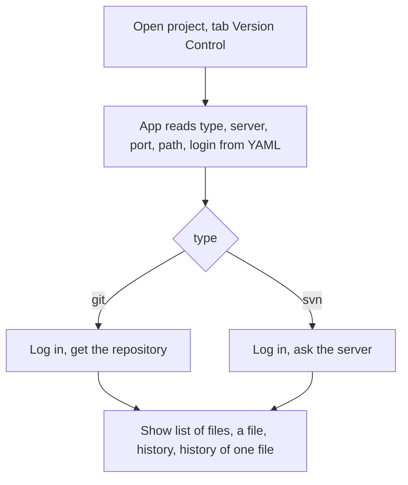

# Plan: Git/SVN integration

## 1) Name

Git/SVN integration

## 2) Planned release version

1.0.1

## 3) Feasible? Checked per function, with the result

| part | desc | state | suggestion |
|---|---|---|---|
| Git | log in to the server | ✅ checked, Windows + Linux | — |
| Git | see the list of files | ✅ checked, Windows + Linux | — |
| Git | read a file | ✅ checked, Windows + Linux | — |
| Git | see the history | ✅ checked, Windows + Linux | — |
| Git | see the history of one file | ✅ checked, Windows + Linux | — |
| SVN | log in to the server | ✅ checked, Windows + Linux | — |
| SVN | see the list of files | ✅ checked, Windows + Linux | — |
| SVN | read a file | ✅ checked, Windows + Linux | — |
| SVN | see the history | ✅ checked, Windows + Linux | — |
| SVN | see the history of one file | ✅ checked, Windows + Linux | — |

Checked: 10 · Unchecked: 0 · Failed: 0

Check: `docs/plans/checks/git-svn-read-check.sh`, run 2026-11-19 on GitHub (Windows + Linux), with own test servers and a login:
https://github.com/GFGMNET/Workspace/actions/runs/44503418842

## 4) Description

Read access to the files from the repository, to show them and their history, for Git and SVN.

## 5) Open points, only about this feature

| id | question |
|---|---|
| 1 | Which way does the app connect: Git over http, ssh or git; SVN over svn or http? |
| 2 | SVN: always show the folder `trunk`, or can it be another folder? |

## 6) Decisions, only about this feature

| id | decision |
|---|---|
| 1 | Server and port are set in the YAML file. |
| 2 | Git and SVN use a login. |
| 3 | The tab is called "Version Control". |
| 4 | The test servers for the checks (Git and SVN, with login) are set up by Claude on GitHub's Windows and Linux machines. |

## 7) Risks

| id | risk | suggestion |
|---|---|---|
| 1 | 1.0.1 can only come after 1.0, and 1.0 for Windows waits for signing. | Build and check 1.0.1 now, release it together with 1.0. |
| 2 | Git has to download a copy of the repository before it can show files; a big repository takes long and uses disk space. | Measure it in the checks of point 3; download once, afterwards only the changes. |

## 8) Detail workflow

### 8a) Flow diagram



### 8b) The YAML file

Git:

```yaml
versions:
  feature: versions
  type: git
  server: 192.168.1.20
  port: 3000
  path: team/project          # which repository on the server
  login: ${secret:git-login}  # from the app's secrets, never written into a file
```

SVN:

```yaml
versions:
  feature: versions
  type: svn
  server: 192.168.1.30
  port: 3690
  path: repos/project/trunk   # which repository, and which folder in it
  login: ${secret:svn-login}  # from the app's secrets, never written into a file
```

### 8c) How it is done

Written after all checks in point 3 have passed, because the checks decide how it is done.
