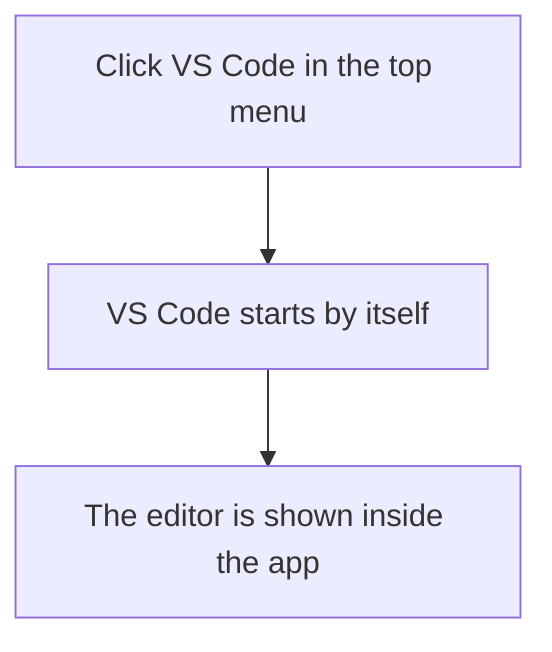

# Plan: VS Code

## 1) Name

VS Code

## 2) Planned release version

1.0.0.5

## 3) Feasible? Checked per function, with the result

| part | desc | state | suggestion |
|---|---|---|---|
| VS Code | click on "VS Code" in the top menu opens the editor inside the app, without a button | ✅ checked, Windows + Linux | — |

Checked: 1 · Unchecked: 0 · Failed: 0

Check: `docs/plans/checks/vscode-check.js` — app server (1.0) and VS Code started without a button, the app opened in a real
browser, the editor appears in the tab on the project folder. Run 2026-11-19 on GitHub, Windows + Linux:
https://github.com/GFGMNET/Workspace/actions/runs/44516435790

## 4) Description

Click on "VS Code" in the top menu → the editor opens inside the app. It replaces the current VS Code integration.

## 5) Open points, only about this feature

| id | question |answer
|---|---|---|
| 1 | While VS Code starts (first time 10–40 s), show "VS Code is starting…"? | Yes
| 2 | Remove the row of buttons above the editor (Reload, Open in new window, Desktop VS Code, Stop)? |yes
| 3 | VS Code not installed: show "VS Code is not installed" with the download link? | yes, Also update the Requirements in the wiki
| 4 | Fix the Linux Stop bug (#78) in this version? | I dont find this issue on git

## 6) Decisions, only about this feature

None.

## 7) Risks

| id | risk | suggestion |
|---|---|---|
| 1 | The first start downloads VS Code's web part once (needs internet). Measured: editor visible after 10–40 s the first time, 3–6 s later. | Open point 1. |
| 2 | VS Code is not installed: it does not start, and a technical message is shown ("'code' is not recognized…" / "code: not found"). | Open point 3. |
| 3 | On Linux, "Stop" does not stop VS Code (issue #78); started automatically, it would keep running. | Open point 4. |

## 8) Detail workflow

### 8a) Flow diagram

### 8b) The YAML file

No change.

### 8c) How it is done

Written after the open points are answered.
