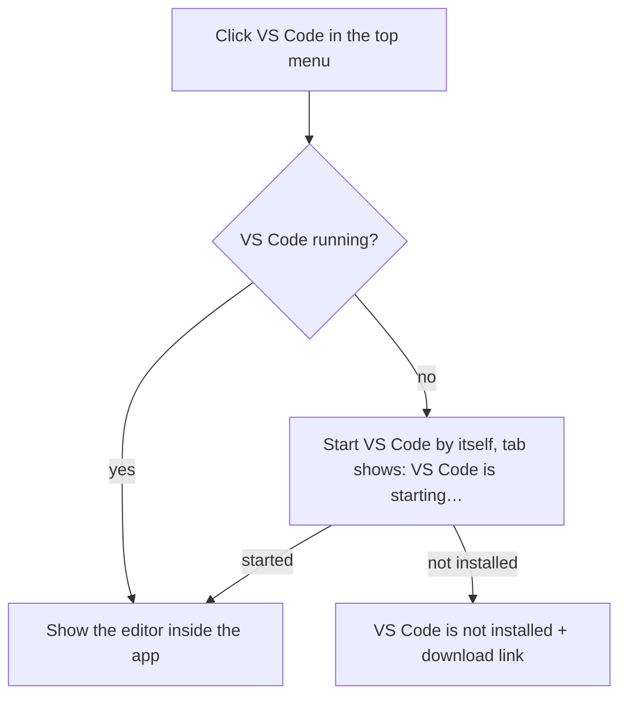

# Plan: VS Code

**Ready 2 Deploy** · **built** (steps 1–5, tests green on Windows + Linux: https://github.com/GFGMNET/Workspace/actions/runs/44571895704) · **tested OK by the maintainer 2026-11-20** (step 6) · **released in 1.0.0** (26 Nov 2026)

## 1) Name

VS Code

## 2) Planned release version

1.0 (was 1.0.0.5, then 1.0.1; moved into 1.0 by the maintainer 2026-11-24 — it is already in the 1.0 betas)

## 3) Feasible? Checked per function, with the result

| part | desc | state | suggestion |
|---|---|---|---|
| VS Code | click on "VS Code" in the top menu opens the editor inside the app, without a button | ✅ checked, Windows + Linux | — |

Checked: 1 · Unchecked: 0 · Failed: 0

Check: `docs/plans/checks/vscode-check.js` — app server (1.0) and VS Code started without a button, the app opened in a real
browser, the editor appears in the tab on the project folder. Run 2026-11-19 on GitHub, Windows + Linux:
https://github.com/GFGMNET/Workspace/actions/runs/44516435790

## 4) Description

Click on "VS Code" in the top menu → the editor opens inside the app. It replaces the current VS Code integration.

## 5) Open points, only about this feature

None.

## 6) Decisions, only about this feature

| id | decision |
|---|---|
| 1 | While VS Code starts, the tab shows "VS Code is starting…". |
| 2 | The row of buttons above the editor (Reload, Open in new window, Desktop VS Code, Stop) is removed. |
| 3 | VS Code not installed: "VS Code is not installed" with the download link; the requirements in the wiki are updated. |
| 4 | Issue #78 is closed because of the new integration; starting and stopping is tested again on Windows and Linux. |

## 7) Risks

| id | risk | suggestion |
|---|---|---|
| 1 | The first start downloads VS Code's web part once (needs internet). Measured: editor visible after 10–40 s the first time, 3–6 s later. | Decision 1. |

## 8) Detail workflow

### 8a) Flow diagram

### 8b) The YAML file

No change.

### 8c) How it is done

| id | desc |
|---|---|
| 1 | `app/public/app.js`, `renderIde`: when VS Code is not running, start it right away (`POST /api/ide/start`), no button; meanwhile "VS Code is starting…" (decision 1). |
| 2 | When it runs: only the editor; the row of buttons and the hint text are removed (decision 2). |
| 3 | VS Code not installed: "VS Code is not installed" with the download link (decision 3). |
| 4 | Automatic test: `docs/plans/checks/vscode-check.js` runs in `rust.yml` on Windows and Linux, including starting and stopping again with the new integration (decision 4). Done when: all green. |
| 5 | Docs: REQUIREMENTS.md (→ wiki page "Requirements", decision 3), DESIGN.md, wiki page "VS Code and Explorer", release notes `docs/releases/v1.0.0.md`. |
| 6 | You test it: click "VS Code" → the editor opens without a button. |
| 7 | Release with 1.0. |
