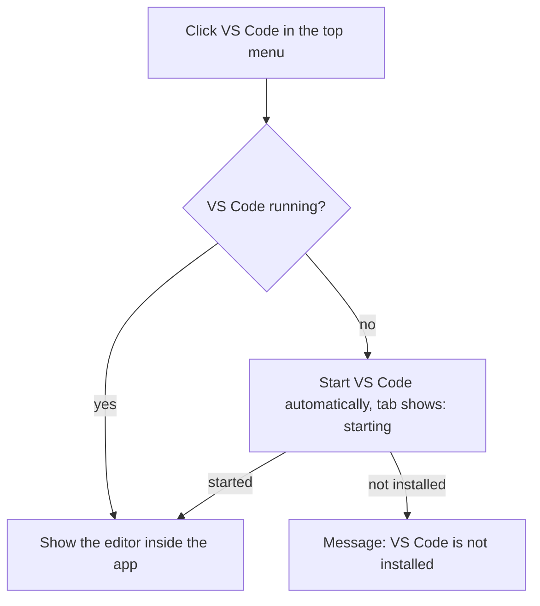

# Plan: VS Code

**Ready 2 Deploy**

## 1) Name

VS Code

## 2) Planned release version

1.0.0.5

## 3) Feasible? Checked per function, with the result

| part | desc | state | suggestion |
|---|---|---|---|
| VS Code | click on "VS Code" in the top menu opens the editor inside the app, without a button | ✅ checked, Windows + Linux | — |

Checked: 1 · Unchecked: 0 · Failed: 0

Check: `docs/plans/checks/vscode-check.js` — app server (1.0) and VS Code started without a button, the app opened in a real
browser, the editor appears in the tab on the project folder. Run 2026-11-19 on GitHub, Windows + Linux:
https://github.com/GFGMNET/Workspace/actions/runs/44516435790

## 4) Description

Click on "VS Code" in the top menu → the editor opens inside the app. It replaces the current VS Code integration.

## 5) Open points, only about this feature

None.

## 6) Decisions, only about this feature

None.

## 7) Risks

| id | risk | suggestion |
|---|---|---|
| 1 | The first start downloads VS Code's web part once (needs internet). Measured: editor visible after 10–40 s the first time, 3–6 s later. | While it starts, the tab shows that VS Code is starting. |
| 2 | VS Code is not installed on the PC. Checked: it does not start, and a technical message is shown ("'code' is not recognized…" / "code: not found"). | Show it in plain words: "VS Code is not installed" with the download link. |
| 3 | On Linux, "Stop" does not stop VS Code (found by the check, issue #78). Started automatically, it would keep running. | Fix #78 in this version. |

## 8) Detail workflow

### 8a) Flow diagram

### 8b) The YAML file

No change. `settings.yaml` → `ide:` stays as it is (command, port, url).

### 8c) How it is done

| id | desc |
|---|---|
| 1 | `app/public/app.js`, `renderIde`: when VS Code is not running, start it right away (`POST /api/ide/start`), no "Start VS Code" button; while it starts, show "VS Code is starting…". |
| 2 | When it runs: only the editor, full size. The row of buttons (Reload, Open in new window, Desktop VS Code, Stop) and the hint text are removed. |
| 3 | VS Code not installed: plain message "VS Code is not installed" with the download link (risk 2). |
| 4 | Fix #78: on Linux, stopping really stops VS Code (`rust/crates/pw-server/src/ide.rs`, `stop`); VS Code is stopped when the app quits. |
| 5 | Automatic test: `docs/plans/checks/vscode-check.js` runs in `rust.yml` on Windows and Linux, plus "after Stop, VS Code is stopped". Done when: all green. |
| 6 | Docs: DESIGN.md, REQUIREMENTS.md, wiki page "VS Code", release notes `docs/releases/v1.0.0.5.md`. |
| 7 | You test it: click "VS Code" → the editor opens without a button. |
| 8 | Release 1.0.0.5 with your OK. |
