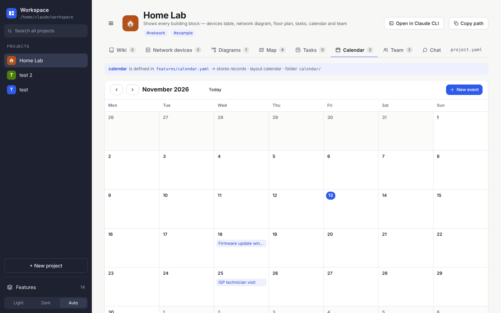

# Calendar

A month view with events (multi-day too), a *coming up* list and events without a date. Click a day to add an event.

## What you need

- Nothing extra: works offline, events are files in the project.



| | |
|---|---|
| Stores | `records` |
| Layout | `calendar` |
| Definition | `data/features/calendar.yaml` |

## Add it to a project

```yaml
calendar:
  - title: Firmware update window
    date: 2026-11-18
```

Or click **+ Feature** in the project's tab row.

## The definition

This is the starter definition. Change it under **Features** in the app, or in the file, and every project that uses it follows.

```yaml
# Calendar. Each event is a record with a date (and optional end date).
name: Calendar
icon: calendar
stores: records
layout: calendar
date_field: date
fields:
  - title
  - name: date
    type: date
  - name: end
    type: date
  - location
  - notes
new_item: Event
```

## Settings

Every setting can also be set **for one project only**, under the feature key in that project's `project.yaml`.

| Setting | What it does | Default |
|---|---|---|
| `name` | Name shown on the tab | from the key |
| `icon` | Tab icon: book, lightbulb, image, folder, puzzle, plug, chat, kanban, calendar, users, map, diagram, contact, server, table, list, cards, file, terminal, issue | by layout |
| `folder` | Folder inside the project where the content goes | the key |
| `search` | Show the search box | true |
| `new_item` | Label of the **+ New** button | Event |
| `aliases` | Other keys in project.yaml that mean this feature | none |
| `date_field` | Field with the (start) date | first date field |
| `end_field` | Field with the end date (multi-day events) | `end` if it exists |
| `fields` | The event's fields | title, date, end, location, notes |

## Fields

Each record is a small YAML file with the fields of the feature:

```yaml
title: Firmware update window
date: 2026-11-18
end: 2026-11-19
location: Office
```

| Type | Input | Notes |
|---|---|---|
| `text` | one line | default |
| `longtext` | several lines | not shown in tables |
| `number` | number | stored as a number |
| `date` / `datetime` | date picker | `2026-11-20`; used by calendar, overview *coming up* |
| `select` | drop-down | needs `options: [a, b, c]` |
| `bool` | tick box | shown as ✓ |
| `url` / `email` | link | clickable |
| `tags` | comma separated | stored as a list |
| `list` | one per line | stored as a list |
| `keyvalue` | `KEY=value` per line | stored as a map (e.g. environment variables) |
| `link` | type-ahead picker | points to pages/records in the project; `to: <feature>` limits it, `multiple: true` allows several |

Without `type:` the type is guessed from the name: `due`, `date`, `start`, `end` → date · `email` → email · `url`, `link`, `website` → url · `notes`, `description` → long text · `tags` → tags · `done`, `active` → bool.

## On disk

```
projects/<project>/calendar/
  firmware-update-window.yaml
```

## Tips

- Any records feature with a `date` field also feeds the Overview's *coming up* list.

See also: [[Features]] · [[Building Blocks|Building-Blocks]] · [[Projects]]
