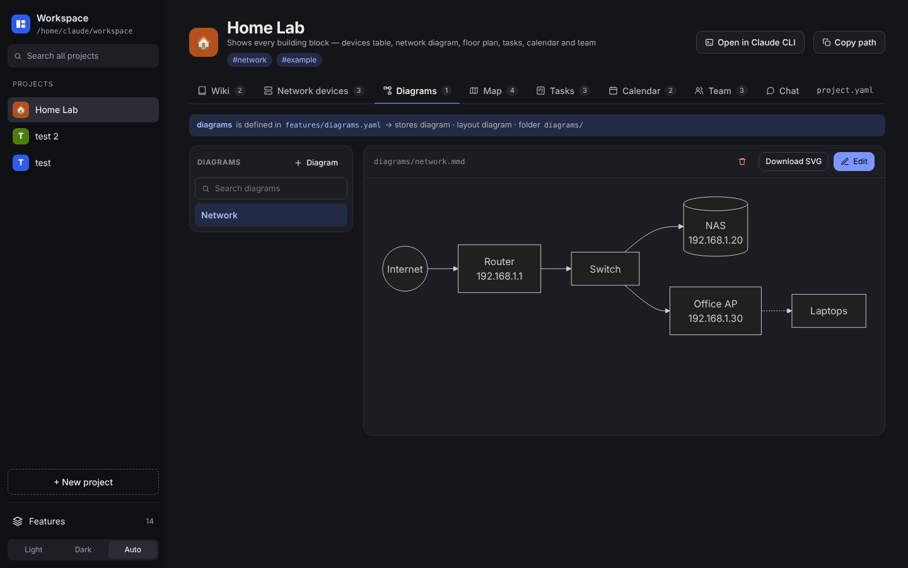

# Diagrams

Diagrams written as text in [Mermaid](https://mermaid.js.org) — flowcharts, sequences, timelines and more — with a live preview while you type and an SVG download.

## What you need

- Nothing extra: works offline (Mermaid is built in).



| | |
|---|---|
| Stores | `diagram` |
| Layout | `diagram` |
| Definition | `data/features/diagrams.yaml` |

## Add it to a project

```yaml
diagrams:
  - Network
```

Or click **+ Feature** in the project's tab row.

## The definition

This is the starter definition. Change it under **Features** in the app, or in the file, and every project that uses it follows.

```yaml
# Diagrams written as Mermaid text (https://mermaid.js.org), one .mmd file each.
name: Diagrams
icon: diagram
stores: diagram
layout: diagram
new_item: Diagram
```

## Settings

Every setting can also be set **for one project only**, under the feature key in that project's `project.yaml`.

| Setting | What it does | Default |
|---|---|---|
| `name` | Name shown on the tab | from the key |
| `icon` | Tab icon: book, lightbulb, image, folder, puzzle, plug, chat, kanban, calendar, users, map, diagram, contact, server, table, list, cards, file, terminal, issue | by layout |
| `folder` | Folder inside the project where the content goes | the key |
| `search` | Show the search box | true |
| `new_item` | Label of the **+ New** button | Diagram |
| `aliases` | Other keys in project.yaml that mean this feature | none |

## Writing a diagram

```
%% Network            ← first line: the title
flowchart LR
  Internet((Internet)) --> Router[Router]
  Router --> NAS[(NAS)]
```

See the [Mermaid syntax](https://mermaid.js.org/intro/syntax-reference.html). Mermaid is bundled, so diagrams work offline. Wiki pages can contain Mermaid blocks too.

## On disk

```
projects/<project>/diagrams/
  network.mmd
```

See also: [[Features]] · [[Building Blocks|Building-Blocks]] · [[Projects]]
