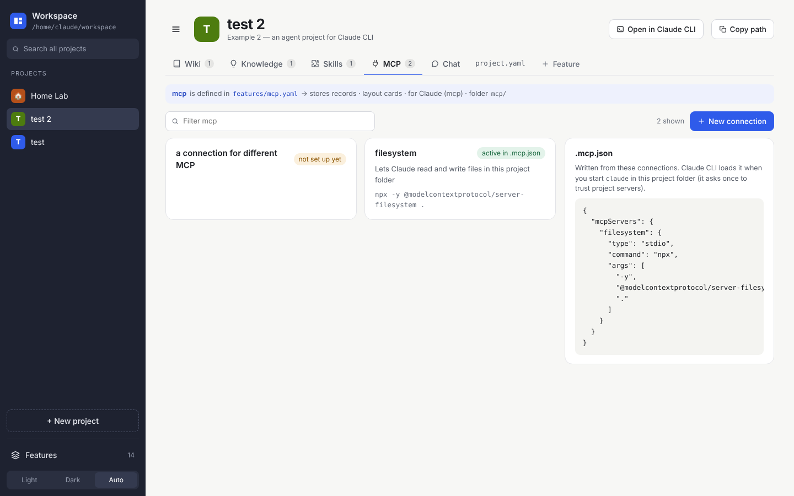

# MCP

Connections to MCP servers for Claude. Each connection is a record; the app writes them to `.mcp.json` in the project folder, which Claude CLI loads (Chat tab or `claude` in a terminal).

## What you need

- [Claude CLI](https://docs.claude.com/en/docs/claude-code) installed and signed in — the connections are used by Claude.
- What each MCP server itself needs (for example Node.js or `uv`, see its own page).



| | |
|---|---|
| Stores | `records` |
| Layout | `cards` |
| Definition | `data/features/mcp.yaml` |

## Add it to a project

```yaml
mcp:
  - name: filesystem
    transport: stdio
    command: npx
    args: [-y, "@modelcontextprotocol/server-filesystem", "."]
  - name: docs
    transport: http
    url: https://example.com/mcp
```

Or click **+ Feature** in the project's tab row.

## The definition

This is the starter definition. Change it under **Features** in the app, or in the file, and every project that uses it follows.

```yaml
# MCP connections for Claude CLI. Each connection is a record; the app writes
# them to .mcp.json in the project folder, which Claude CLI loads on start.
name: MCP
icon: plug
stores: records
layout: cards
for_claude: mcp
new_item: Connection
```

## Settings

Every setting can also be set **for one project only**, under the feature key in that project's `project.yaml`.

| Setting | What it does | Default |
|---|---|---|
| `name` | Name shown on the tab | from the key |
| `icon` | Tab icon: book, lightbulb, image, folder, puzzle, plug, chat, kanban, calendar, users, map, diagram, contact, server, table, list, cards, file, terminal, issue | by layout |
| `folder` | Folder inside the project where the content goes | the key |
| `search` | Show the search box | true |
| `new_item` | Label of the **+ New** button | Connection |
| `aliases` | Other keys in project.yaml that mean this feature | none |
| `for_claude` | `mcp`: write the records to `.mcp.json` | `mcp` |

## Connection fields

| Field | For | Example |
|---|---|---|
| `name` | all | `github` |
| `description` | all | what it is for |
| `transport` | all | `stdio` (a local program), `http` or `sse` (a server) |
| `command` + `args` | stdio | `npx` + `[-y, "@modelcontextprotocol/server-filesystem", "."]` |
| `url` | http / sse | `https://api.githubcopilot.com/mcp/` |
| `env` | stdio | `KEY=value` lines |
| `headers` | http / sse | `Authorization=Bearer …` |

A connection without command/url is shown as **not set up yet** and left out of `.mcp.json`.

## On disk

```
projects/<project>/mcp/filesystem.yaml
projects/<project>/.mcp.json        (written by the app)
```

## Tips

- On Windows, servers started with `npx` usually need `command: cmd` and `args: [/c, npx, -y, ...]`.
- Keep tokens out of the records: save them under **Secrets** and write `${secret:name}` in `env`, `headers`, `args` or `url`. `.mcp.json` then only holds `${PW_SECRET_NAME}`, and the chat fills in the value. See [[Secrets]].

See also: [[Features]] · [[Building Blocks|Building-Blocks]] · [[Projects]]
