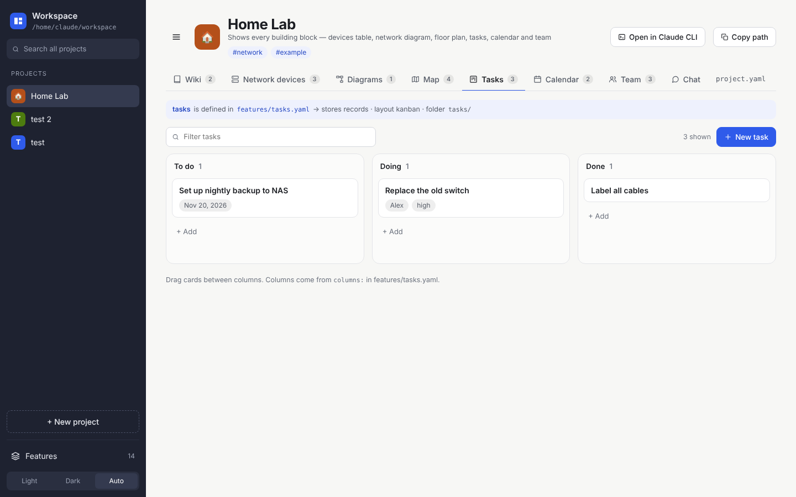

# Tasks

A Kanban board: cards in columns, dragged from *To do* to *Done*. Open tasks with a due date appear on the project **Overview** (overdue ones in red).

## What you need

- Nothing extra: works offline, tasks are files in the project.



| | |
|---|---|
| Stores | `records` |
| Layout | `kanban` |
| Definition | `data/features/tasks.yaml` |

## Add it to a project

```yaml
tasks:
  - title: Replace the old switch
    status: Doing
    owner: Alex
    due: 2026-11-20
```

Or click **+ Feature** in the project's tab row.

## The definition

This is the starter definition. Change it under **Features** in the app, or in the file, and every project that uses it follows.

```yaml
# Kanban board. Cards are records; the column is the "status" field.
name: Tasks
icon: kanban
stores: records
layout: kanban
columns: [To do, Doing, Done]
fields:
  - title
  - owner
  - name: due
    type: date
  - name: priority
    type: select
    options: [low, normal, high]
  - name: related
    type: link          # links to any page/record in the project (add  to: devices  to limit it)
    multiple: true
  - notes
new_item: Task
```

## Settings

Every setting can also be set **for one project only**, under the feature key in that project's `project.yaml`.

| Setting | What it does | Default |
|---|---|---|
| `name` | Name shown on the tab | from the key |
| `icon` | Tab icon: book, lightbulb, image, folder, puzzle, plug, chat, kanban, calendar, users, map, diagram, contact, server, table, list, cards, file, terminal, issue | by layout |
| `folder` | Folder inside the project where the content goes | the key |
| `search` | Show the search box | true |
| `new_item` | Label of the **+ New** button | Task |
| `aliases` | Other keys in project.yaml that mean this feature | none |
| `columns` | The columns, in order | `[To do, Doing, Done]` |
| `status_field` | Field that holds the column | `status` |
| `fields` | The card's fields (see below) | title, owner, due, priority, related, notes |
| `title_field` | Field used as the card title | first field |

## Fields

Each record is a small YAML file with the fields of the feature:

```yaml
title: Replace the old switch
status: Doing
owner: Alex
due: 2026-11-20
priority: high
related: [devices/router]
```

| Type | Input | Notes |
|---|---|---|
| `text` | one line | default |
| `longtext` | several lines | not shown in tables |
| `number` | number | stored as a number |
| `date` / `datetime` | date picker | `2026-11-20`; used by calendar, overview *coming up* |
| `select` | drop-down | needs `options: [a, b, c]` |
| `bool` | tick box | shown as ✓ |
| `url` / `email` | link | clickable |
| `tags` | comma separated | stored as a list |
| `list` | one per line | stored as a list |
| `keyvalue` | `KEY=value` per line | stored as a map (e.g. environment variables) |
| `link` | type-ahead picker | points to pages/records in the project; `to: <feature>` limits it, `multiple: true` allows several |

Without `type:` the type is guessed from the name: `due`, `date`, `start`, `end` → date · `email` → email · `url`, `link`, `website` → url · `notes`, `description` → long text · `tags` → tags · `done`, `active` → bool.

## On disk

```
projects/<project>/tasks/
  replace-the-old-switch.yaml
```

## Tips

- The last column counts as *done* for the Overview.
- `layout: table` shows the same tasks as a table.

See also: [[Features]] · [[Building Blocks|Building-Blocks]] · [[Projects]]
