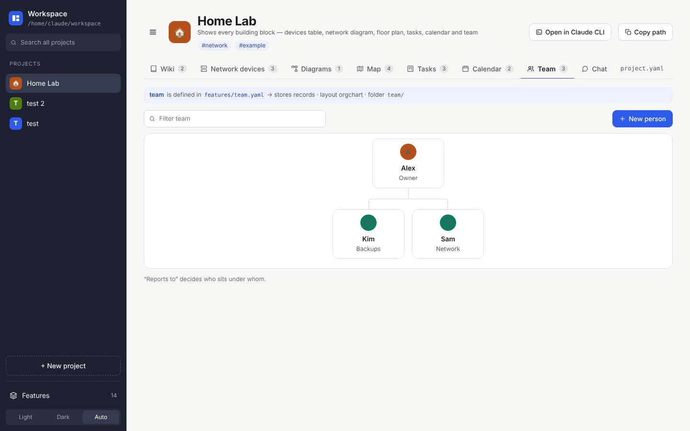

# Team

An org chart: people (or roles) as a tree, built from who reports to whom.

## What you need

- Nothing extra: works offline, people are files in the project.



| | |
|---|---|
| Stores | `records` |
| Layout | `orgchart` |
| Definition | `data/features/team.yaml` |

## Add it to a project

```yaml
team:
  - name: Alex
    role: Owner
  - name: Sam
    role: Network
    reports_to: alex
```

Or click **+ Feature** in the project's tab row.

## The definition

This is the starter definition. Change it under **Features** in the app, or in the file, and every project that uses it follows.

```yaml
# Org chart. Each person is a record; "reports_to" points to another person.
name: Team
icon: users
stores: records
layout: orgchart
parent_field: reports_to
fields:
  - name
  - role
  - email
  - phone
  - reports_to
new_item: Person
```

## Settings

Every setting can also be set **for one project only**, under the feature key in that project's `project.yaml`.

| Setting | What it does | Default |
|---|---|---|
| `name` | Name shown on the tab | from the key |
| `icon` | Tab icon: book, lightbulb, image, folder, puzzle, plug, chat, kanban, calendar, users, map, diagram, contact, server, table, list, cards, file, terminal, issue | by layout |
| `folder` | Folder inside the project where the content goes | the key |
| `search` | Show the search box | true |
| `new_item` | Label of the **+ New** button | Person |
| `aliases` | Other keys in project.yaml that mean this feature | none |
| `parent_field` | Field that says who is above | `reports_to` |
| `fields` | The person's fields | name, role, email, phone, reports_to |

## Fields

Each record is a small YAML file with the fields of the feature:

```yaml
name: Sam
role: Network
email: sam@example.com
reports_to: alex
```

| Type | Input | Notes |
|---|---|---|
| `text` | one line | default |
| `longtext` | several lines | not shown in tables |
| `number` | number | stored as a number |
| `date` / `datetime` | date picker | `2026-11-20`; used by calendar, overview *coming up* |
| `select` | drop-down | needs `options: [a, b, c]` |
| `bool` | tick box | shown as ✓ |
| `url` / `email` | link | clickable |
| `tags` | comma separated | stored as a list |
| `list` | one per line | stored as a list |
| `keyvalue` | `KEY=value` per line | stored as a map (e.g. environment variables) |
| `link` | type-ahead picker | points to pages/records in the project; `to: <feature>` limits it, `multiple: true` allows several |

Without `type:` the type is guessed from the name: `due`, `date`, `start`, `end` → date · `email` → email · `url`, `link`, `website` → url · `notes`, `description` → long text · `tags` → tags · `done`, `active` → bool.

`reports_to` holds the id (file name) or the name of another person; people without it are at the top.

## On disk

```
projects/<project>/team/
  alex.yaml
  sam.yaml
```

See also: [[Features]] · [[Building Blocks|Building-Blocks]] · [[Projects]]
