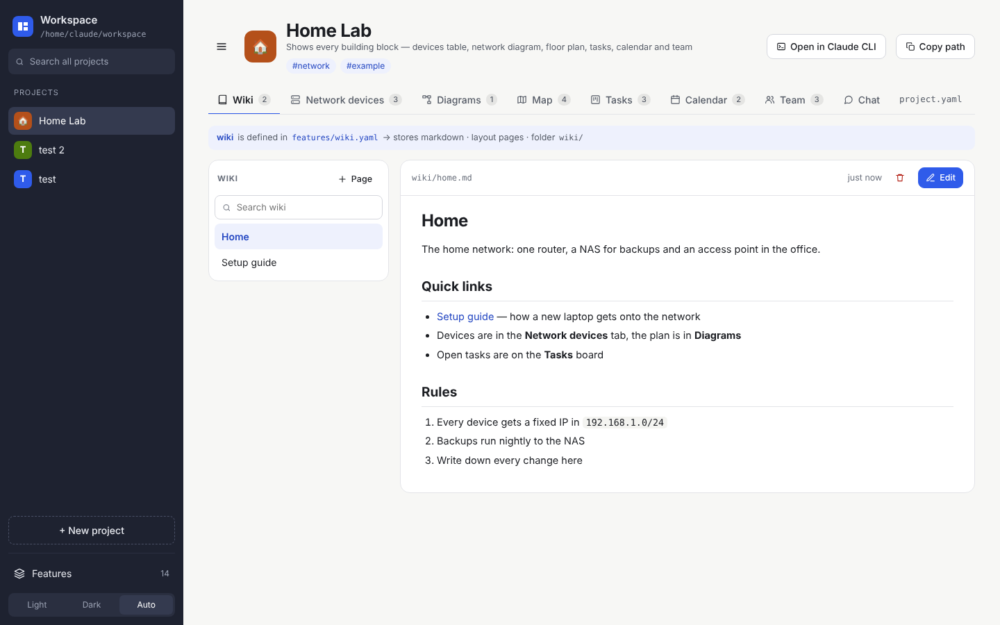

# Wiki

Markdown pages with a page list, full-text search and an editor with live preview. Good for documentation, how-tos and notes that link to each other.

## What you need

- Nothing extra: works offline, pages are Markdown files in the project.



| | |
|---|---|
| Stores | `markdown` |
| Layout | `pages` |
| Definition | `data/features/wiki.yaml` |

## Add it to a project

```yaml
wiki:
  - Home            # first page, created once
  - Setup guide
```

Or click **+ Feature** in the project's tab row.

## The definition

This is the starter definition. Change it under **Features** in the app, or in the file, and every project that uses it follows.

```yaml
# Wiki: Markdown pages with a page list and search.
name: Wiki
icon: book
stores: markdown
layout: pages
search: true
new_item: Page
```

## Settings

Every setting can also be set **for one project only**, under the feature key in that project's `project.yaml`.

| Setting | What it does | Default |
|---|---|---|
| `name` | Name shown on the tab | from the key |
| `icon` | Tab icon: book, lightbulb, image, folder, puzzle, plug, chat, kanban, calendar, users, map, diagram, contact, server, table, list, cards, file, terminal, issue | by layout |
| `folder` | Folder inside the project where the content goes | the key |
| `search` | Show the search box | true |
| `new_item` | Label of the **+ New** button | Page |
| `aliases` | Other keys in project.yaml that mean this feature | none |
| `layout` | `pages` (list + page), `cards` (cards with summary and tags) or `list` | `pages` |

## Writing pages

- Pages are Markdown (`.md`). The first `# Heading` is the title.
- **Front matter** (optional, at the very top) adds information:
  ```markdown
  ---
  title: VPN setup
  tags: [network, setup]
  description: Short summary shown on cards
  ---
  ```
- **Links:** `[[Page title]]` links to any page or record of the project; `[[devices/router]]` to an exact item; a link to a page that doesn't exist yet creates it.
- **Pictures:** paste (Ctrl+V) or drop them into the editor. They are saved in `assets/` next to the page.
- **Diagrams** inside a page: a ` ```mermaid ` code block.
- Every page shows **Mentioned in**: the pages and records that link to it.

## On disk

```
projects/<project>/wiki/
  home.md
  setup-guide.md
  assets/
    screenshot-20261116-0912.png
```

## Tips

- Want the same feature twice? Use another key: `handbook: { feature: wiki }`.
- Point a wiki at an existing folder of Markdown files: `docs: { feature: wiki, folder: docs }`.

See also: [[Features]] · [[Building Blocks|Building-Blocks]] · [[Projects]]
