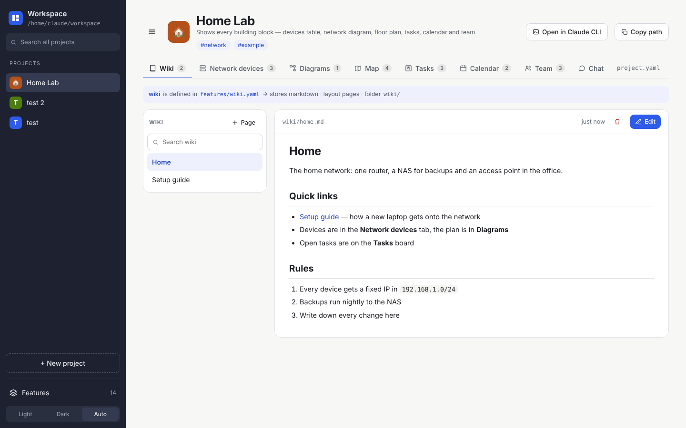
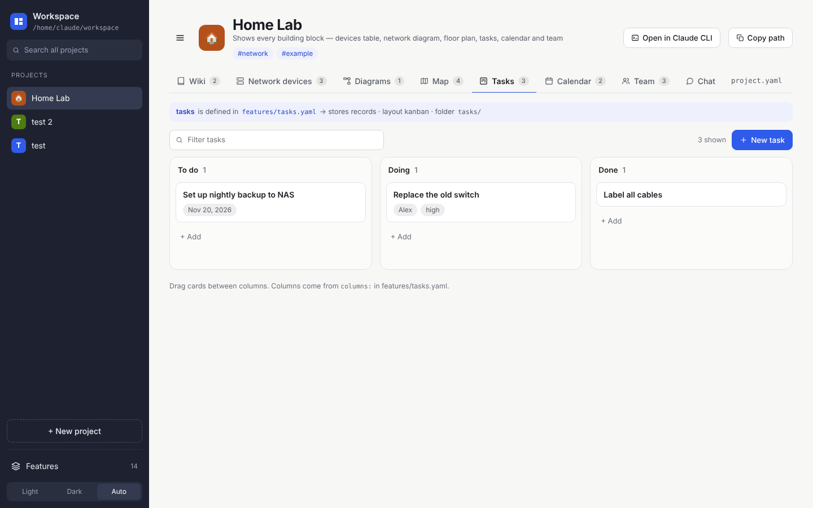
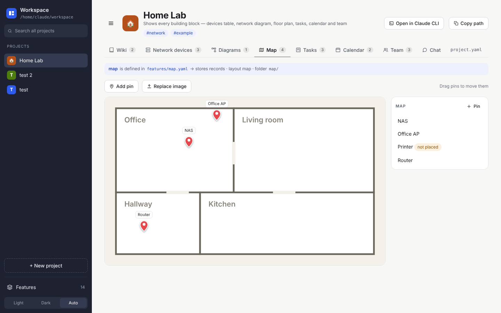
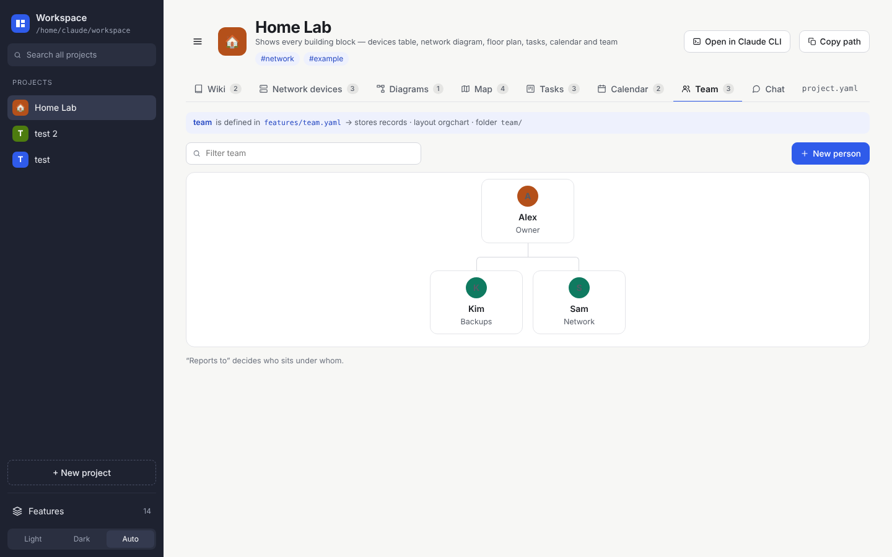
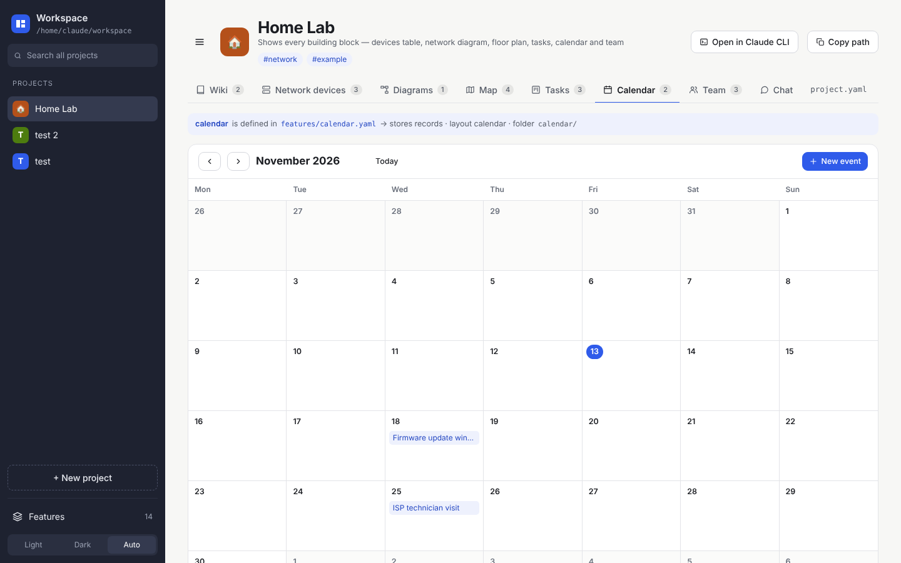
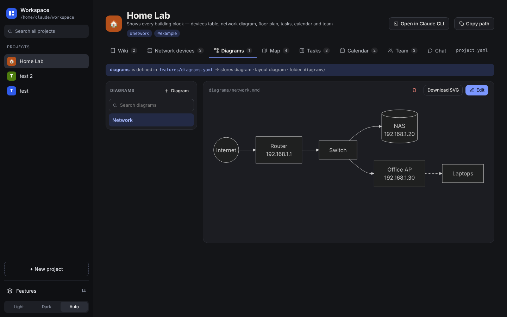

# Building blocks

A feature is a combination of **what it stores** and **how it looks**. Everything is saved as plain files.

| Layout | Stores | Saved as | What you get |
|---|---|---|---|
| **pages** | markdown | `<folder>/<page>.md` | Page list with full-text search, editor with live preview, `[[links]]`, Mermaid diagrams in pages, paste or drop pictures |
| **cards** | markdown / records | `.md` / `.yaml` | Cards with summary and tags, tag filter |
| **list** | markdown / records | `.md` / `.yaml` | Simple list |
| **grid** | images | `<folder>/<album>/*.jpg…` | Albums with covers, sort by date/name/size, group by album/month/year, photo dates from EXIF, lightbox |
| **files** | files | any files | Folders, upload, download |
| **code** | files | any text files | Explorer with code editor (syntax colours), script templates, Open in VS Code |
| **table** | records | `<folder>/<item>.yaml` | Sortable, filterable table |
| **kanban** | records | `.yaml` | Columns, drag cards between them |
| **calendar** | records | `.yaml` | Month view, multi-day events, coming up |
| **orgchart** | records | `.yaml` | Tree from `reports_to` |
| **map** | records | `.yaml` + `_map.png` | Your own picture (floor plan, site plan) with draggable pins; works offline |
| **diagram** | diagram | `<folder>/<name>.mmd` | Mermaid text with live preview, SVG download |
| **chat** | chat | `chats/<date>-<title>.json` | Chat with Claude CLI in the project folder (see [[Claude]]) |

| | |
|---|---|
|  |  |
|  |  |
|  |  |

## Links between features

- **In pages:** `[[Router]]` links to the item with that title in any feature, looking in the same feature first. `[[devices/router]]` names it exactly, and `[[Router|the router]]` changes the text shown.
- **In records:** a `link` field picks pages or records with a type-ahead box, and shows them as clickable chips.
- **Mentioned in:** every page and record lists what links to it.

## Overview

Every project opens on an **Overview** with:
- a tile per feature with its count
- *coming up* in the next 30 days (from every date field)
- open Kanban tasks, with overdue ones in red
- recently changed items
