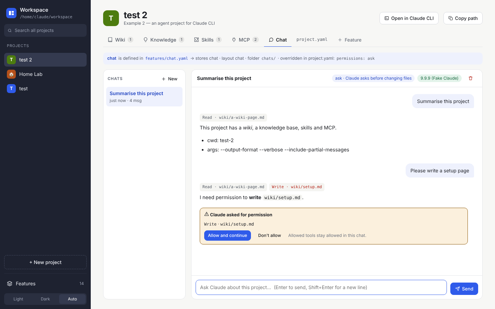
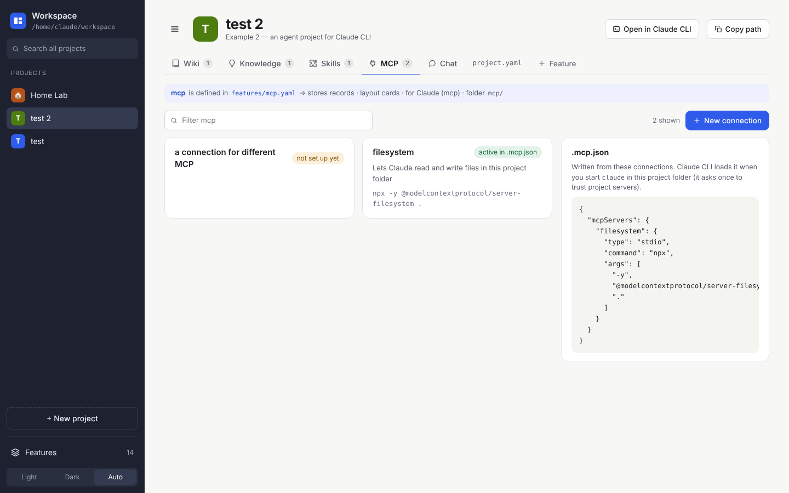

# Claude

The workspace is built to work with **Claude CLI**. Claude always works inside one project's folder, so it sees exactly that project's files, skills and MCP connections.

## Chat

Add the **Chat** feature to a project. Each message runs `claude` in the project folder, and the answers stream in live. Conversations are saved in `chats/` and can be continued later.

What Claude may do is set **per project** in `project.yaml`:

```yaml
chat:
  permissions: ask      # ask | auto | read-only
```

| Mode | Behaviour |
|---|---|
| `ask` | When Claude wants to change something, the chat shows **Claude asked for permission → Allow and continue**. Allowed tools stay allowed in that chat |
| `auto` | Claude may change files directly |
| `read-only` | Claude can only read |



## Skills and MCP

- **Skills** feature: each skill is `.claude/skills/<name>/SKILL.md` in the project. Claude CLI uses them automatically.
- **MCP** feature: each connection is a record; the app writes them to `.mcp.json`, which Claude CLI loads.
  - A local server needs `command` + `args`. On Windows, `npx` usually needs command `cmd` and args `/c`, `npx`, …
  - A remote server needs a `url`.



## Claude CLI in a terminal

**Claude CLI** in the project header copies `cd <project> && claude`. Skills and MCP work there too.

## Let Claude manage the workspace

Register the workspace MCP server once:

```
claude mcp add workspace --scope user -- node "C:\Workspace\app\mcp.js"
```

Claude can then list, create and edit projects, features, pages and records from anywhere, for example: *"create a project Office Move with a wiki, tasks and contacts"*.

Tools: `list_projects`, `get_project`, `create_project`, `update_project_yaml`, `list_features`, `save_feature`, `list_items`, `read_item`, `create_item`, `write_item`, `backlinks`, `search`.
