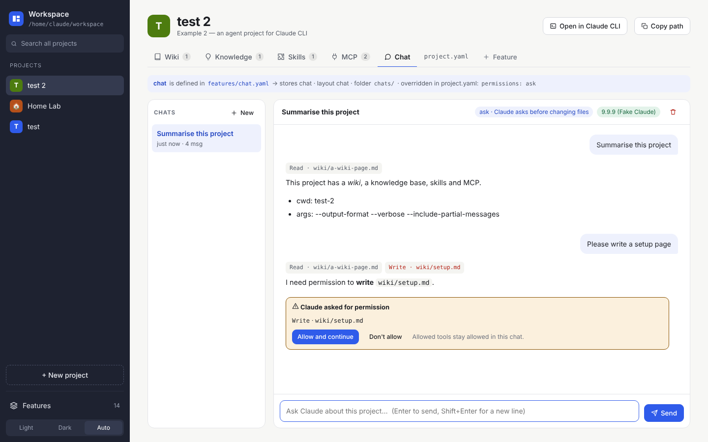

# Chat

Chat inside the project folder — with **Claude** (Claude CLI) or with a **model in LM Studio** on your PC or in your network.
The model sees the project's files and — if allowed — creates, changes and deletes files and runs commands; the app shows the changes right away.

## What you need

One of the two (the setting `engine:` decides):

- **Claude** (default, `engine: claude`): [Claude CLI](https://docs.claude.com/en/docs/claude-code) installed and signed in (`claude` works in a terminal), and an internet connection.
- **LM Studio** (`engine: lmstudio`): only [LM Studio](https://lmstudio.ai) with a loaded model **with tool support** (the hammer symbol in LM Studio, e.g. a Qwen Coder model) and its server turned on (**Developer → Start server**). No Claude CLI, no internet.



| | |
|---|---|
| Stores | `chat` |
| Layout | `chat` |
| Definition | `data/features/chat.yaml` |

## Add it to a project

```yaml
chat:
  permissions: ask
```

With LM Studio:

```yaml
chat:
  engine: lmstudio                # claude (default) or lmstudio
  url: http://127.0.0.1:1234      # where LM Studio runs (only for lmstudio)
  model: qwen/qwen3-coder-30b     # the model in LM Studio
  permissions: ask                # as with Claude
```

Or click **+ Feature** in the project's tab row.

## The definition

This is the starter definition. Change it under **Features** in the app, or in the file, and every project that uses it follows.

```yaml
# Chat with Claude CLI, running inside the project folder.
# permissions: ask (Claude asks before changing files) | auto (may edit files) | read-only
# A project can override any of this, e.g.  chat: { permissions: auto }
name: Chat
icon: chat
stores: chat
layout: chat
permissions: ask
context: [wiki, knowledge]
```

## Settings

Every setting can also be set **for one project only**, under the feature key in that project's `project.yaml`.

| Setting | What it does | Default |
|---|---|---|
| `name` | Name shown on the tab | from the key |
| `icon` | Tab icon: book, lightbulb, image, folder, puzzle, plug, chat, kanban, calendar, users, map, diagram, contact, server, table, list, cards, file, terminal, issue | by layout |
| `folder` | Folder inside the project where the content goes | the key |
| `search` | Show the search box | false |
| `new_item` | Label of the **+ New** button | Chat |
| `aliases` | Other keys in project.yaml that mean this feature | none |
| `engine` | Who answers: `claude` (Claude CLI) or `lmstudio` (a model in LM Studio) | `claude` |
| `url` | Only for `lmstudio`: where LM Studio runs | `http://127.0.0.1:1234` |
| `permissions` | `ask` — asks in the chat before changing files or running commands (**Allow** · **Always allow in this chat** · **Don't allow**) · `auto` — may change files (commands still ask) · `read-only` — only reads. The same for Claude and LM Studio. | `ask` |
| `allowed_tools` | Tools always allowed, e.g. `[Read, Grep, "Bash(git status)"]` | none |
| `context` | Features Claude should look at first, e.g. `[wiki, knowledge]` | none |
| `instructions` | Extra instructions sent with the first message | none |
| `model` | With `claude`: the Claude model alias, e.g. `sonnet`. With `lmstudio`: the LM Studio model, e.g. `qwen/qwen3-coder-30b` (required) | Claude CLI default |
| `folder` | Where conversations are saved | `chats` |

## Requirements

Claude CLI installed and signed in once (`claude` in a terminal). The chat shows the CLI version, or *Claude CLI not found*.

## How it works

- **Claude:** each message runs `claude -p` in the project folder (streamed), with `--resume` to continue the conversation and `--mcp-config .mcp.json` when the project has MCP connections.
- **LM Studio:** the app sends the conversation to LM Studio (`/v1/chat/completions`, streamed) with its own tools: read, create/change, delete and list files in the project folder, and run commands there. Deleted files go to the project's `.trash` folder. Skills and MCP connections work only with Claude for now.

## LM Studio: good to know

- If LM Studio can't be reached or the model isn't loaded, the chat says so clearly. Start LM Studio, load the model, turn on the server.
- LM Studio on another computer: put its address in `url:` (e.g. `http://192.168.1.20:1234`). LM Studio has **no password** — do this only in your own network.
- Small models sometimes don't use the tools and just answer with text. Use a model with tool support. On a weak PC answers can be slow.

## On disk

```
projects/<project>/chats/
  2026-11-16-summarise-this-project.json
```

## Tips

- Set permissions per project — e.g. `auto` for a scratch project, `read-only` for client data.

See also: [[Features]] · [[Building Blocks|Building-Blocks]] · [[Projects]]

## While Claude works
- You can go to another page while Claude answers. It keeps working; come back to the chat to see the answer so far and any question it is waiting for.
- **Stop** stops Claude.
- **Always allow in this chat** counts at once: Claude isn't asked again for that tool, not even later in the same answer (e.g. each website it reads).

