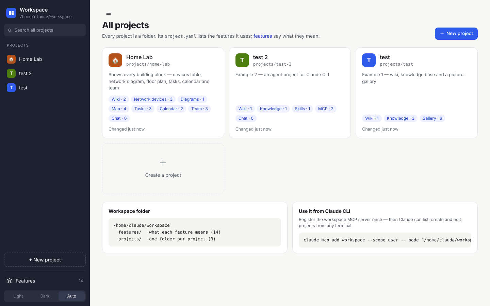

# Project Workspace

One workspace for very different projects. A project's `project.yaml` says **which features** it has, and `features/*.yaml` says **what they mean**. There is no database: everything is plain files. It works with **Claude CLI** and **VS Code**.

## Start here

- **[[Getting Started|Getting-Started]]**: install, first project, first feature (10 minutes)
- [[Desktop App|Desktop-App]]: its own window, tray, reminders, start with Windows
- [[Projects]]: how `project.yaml` works, templates
- [[Features]]: define your own feature types (all settings), with a **page per feature** (e.g. [[Feature-Wiki]], [[Feature-Tasks]], [[Feature-Chat]])
- [[Building Blocks|Building-Blocks]]: pages, tables, Kanban, calendar, org chart, map, diagrams, scripts, chat …
- [[Claude]]: chat, skills, MCP, workspace MCP server
- [[VS Code and Explorer|VS-Code-and-Explorer]]
- [[Secrets]]: API keys and passwords, kept encrypted
- [[Security]]: what protects you, how security updates arrive
- [[Data and Updates|Data-and-Updates]]: where your data lives, how to update
- [[Backup]] · [[Import and Export|Import-and-Export]]: what to back up; bringing files in and out
- [[FAQ]]
- **[[Requirements]]**: everything the workspace should do, with status (done, planned, open) and the GitHub issue for each

## For developers

- [[Design]]: architecture and rebuild guide
- Bugs: [[Known bugs|Known-bugs]] and [[Known hiccups|Known-hiccups]] first, then [Issues](https://github.com/GFGMNET/Workspace/issues)
- Ideas: [[Vote for features|Vote-for-features]] or the form [New idea](https://github.com/GFGMNET/Workspace/issues/new?template=new-idea.yml)
- Security: [[Known security issues|Known-security-issues]]; report new ones privately (Security tab → Report a vulnerability)

> These pages are generated from `docs/` in the repository. Edit them there, not here, or your changes are overwritten on the next update.
