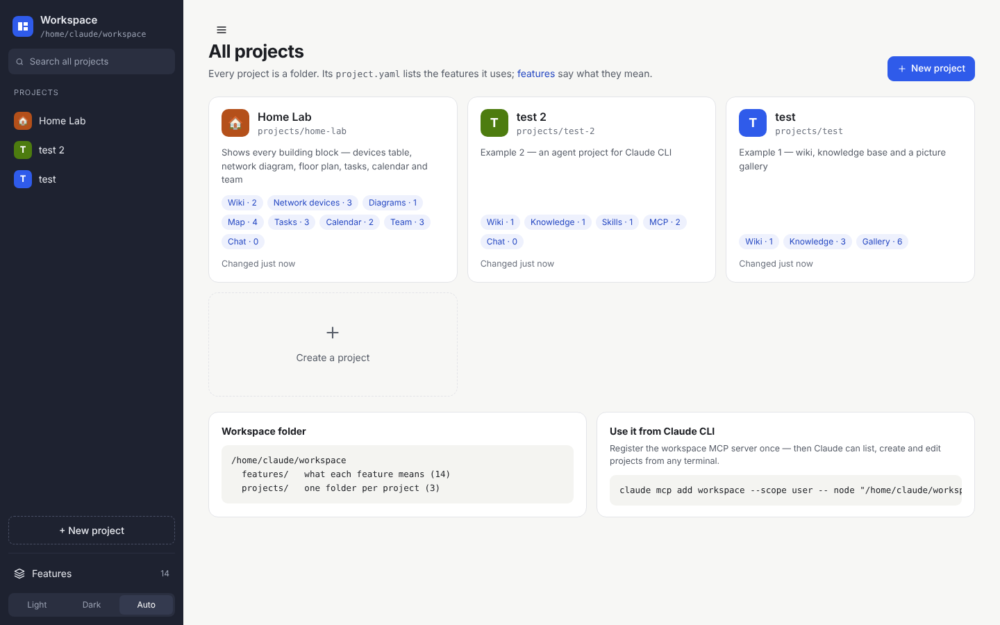

# Project Workspace

One workspace for very different projects. A project's `project.yaml` says **which features** it has, and `features/*.yaml` says **what they mean**. There is no database: everything is plain files. It works with **Claude CLI** and **VS Code**.

## Start here

- **[[Getting Started|Getting-Started]]**: install, first project, first feature (10 minutes)
- [[Projects]]: how `project.yaml` works
- [[Features]]: define your own feature types (all settings)
- [[Building Blocks|Building-Blocks]]: pages, tables, Kanban, calendar, org chart, map, diagrams, scripts, chat …
- [[Claude]]: chat, skills, MCP, workspace MCP server
- [[VS Code and Explorer|VS-Code-and-Explorer]]
- [[Data and Updates|Data-and-Updates]]: where your data lives, how to update
- [[FAQ]]

## For developers

- [[Design]]: architecture and rebuild guide
- [[Requirements]]: every requirement with its status
- [Issues](https://github.com/GFGMNET/Workspace/issues): bugs and ideas

> These pages are generated from `docs/` in the repository. Edit them there, not here, or your changes are overwritten on the next update.
